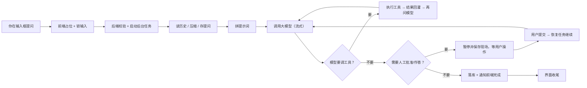
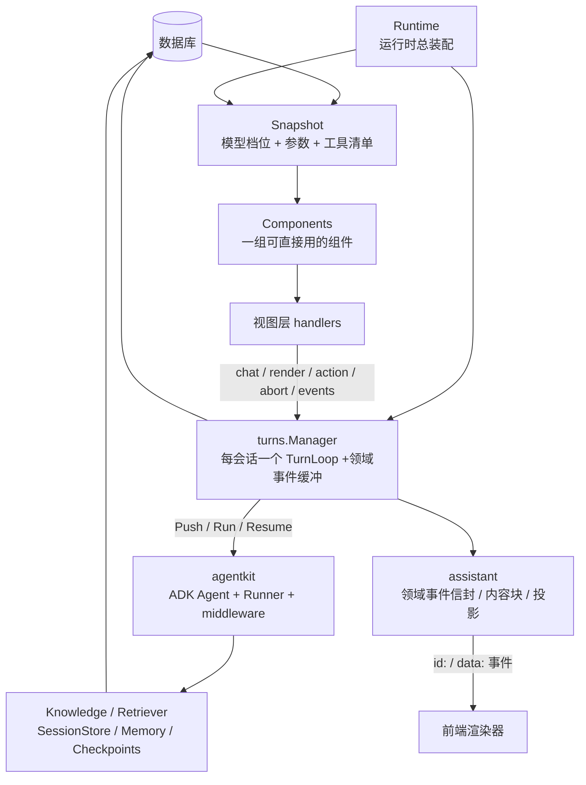
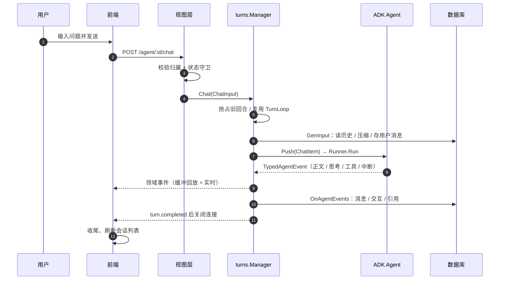
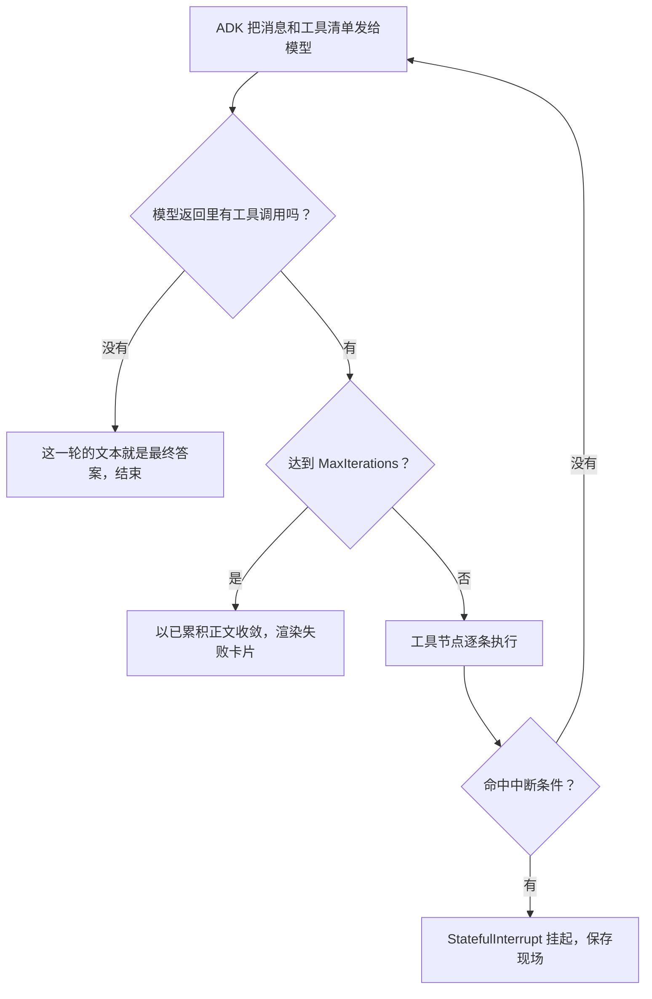
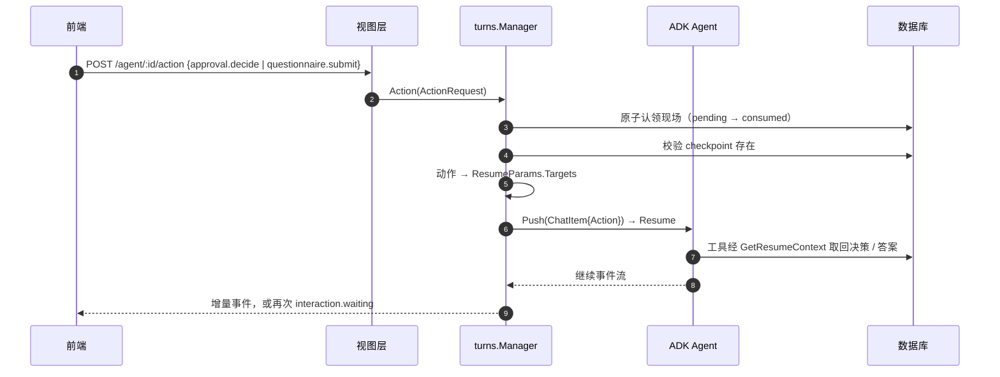
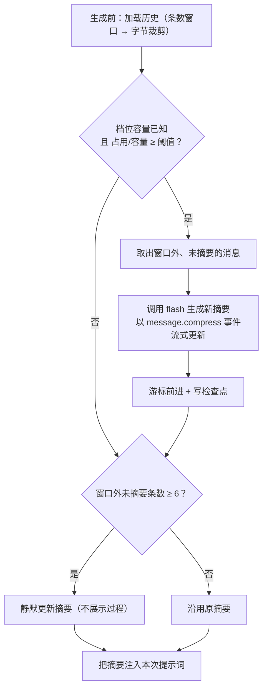
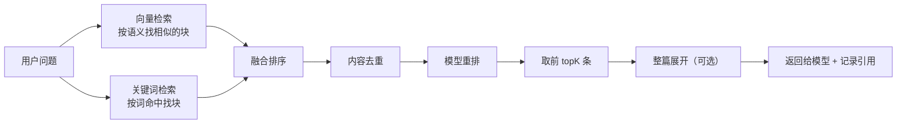
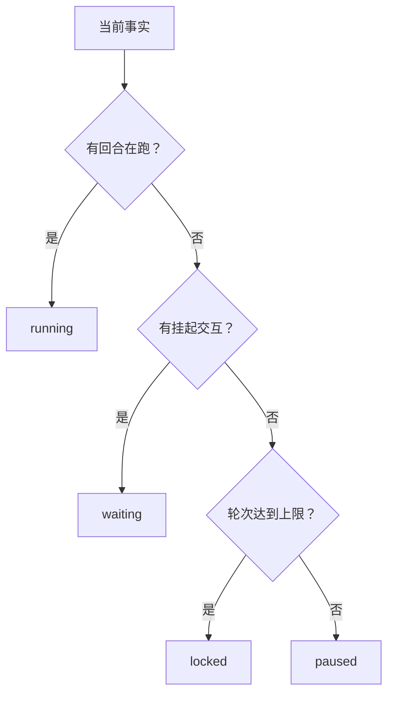

# AI Agent 功能架构详解

> 状态：已校对
> 责任人：@olinex
> 依据：`internal/ai`、`internal/manager/views/ai`

面向：刚接触本项目、或第一次维护 AI 助手功能的研发同学。
> 目标：读完之后，你能回答这三个问题——**一轮对话的数据存在哪、怎么流动、我改代码时不能破坏什么**。
> 说明：本文尽量用日常语言解释概念，专业词第一次出现时都会给出解释；需要精确字段和行号时，去第 11 章附录查。

## 0. 怎么读这篇文档

这篇文档不是 API 手册，而是一份「带地图的导览」。建议按你的目的选一条路线：

| 你的目的 | 建议阅读顺序 | 预计关注点 |
| --- | --- | --- |
| 只想搞懂它怎么跑起来的 | 第 1 章 → 第 2 章 → 第 5 章 | 故事、术语、一次提问的完整旅程 |
| 要改前端或对接 SSE | 第 2 章 → 第 5.5 节 → 第 9 章 |领域事件、内容块、交互状态 |
| 要改后端逻辑（工具、记忆、检索） | 第 2 章 → 第 4 章 → 第 6~8 章 → 第 10 章 | 数据结构、工具/审批、压缩、检索、不变量 |
| 只想查某个字段/枚举/参数 | 第 11 章附录 | 枚举、参数、索引、源码位置 |

读的时候如果遇到不认识的词，先翻回第 2 章的术语表，那里有比喻和「为什么需要它」。

---

## 1. 先建立直觉：一次提问到底发生了什么

先不看代码，想象一个场景：

> 你在页面右侧的助手抽屉里输入「帮我总结一下昨天那批告警的原因」，按下回车。

接下来系统做的事情，可以拆成 10 步：

1. **前端先占位**：界面上出现一个空的助手气泡，输入框被锁住，旁边显示「思考中」。
2. **请求到达后端**：后端先检查「这个会话是不是你的」「当前会话能不能发新问题」，然后交给会话的 `TurnLoop` 在后台执行，而不是把这次生成绑在你这个浏览器连接上。
3. **回合开始跑**：后台回合先把「这个会话之前聊过什么」读出来，必要时把太长的旧对话压缩成摘要，再把这次提问存进数据库。
4. **拼提示词**：`GenModelInput` 把系统提示、会话摘要、长期记忆、最近的历史消息、当前业务现场和你的提问，按固定顺序拼成一份「给模型看的材料」。
5. **问模型**：把材料发给大模型（可以理解为一次 HTTP 请求），模型开始一个字一个字地往回流。
6. **边收边推**：后台每收到一小段文字，就把它投影成领域事件立刻通过一条长连接（SSE）推给浏览器，所以你看到的是「打字机效果」，而不是等全部生成完才出现。
7. **可能要调工具**：如果模型说「我需要查知识库」或「我需要算一下」，ADK 工具节点就执行对应工具，把结果再塞回对话，让模型继续回答。这个过程可能来回好几轮。
8. **可能要问用户**：如果模型调用了「向用户提问」的工具，或者某次工具操作很危险需要你批准，后台会通过 eino 中断**挂起**这一轮并保存现场，等你在界面上点「批准」或填完问卷。
9. **收尾落库**：回答生成完，后台把 eino 原生消息、交互卡片记录、引用来源、token 用量、耗时写进数据库，并以终局卡片结束这一轮。
10. **界面收尾**：前端把流式过程中累积的内容块收敛为最终态，解锁输入框，刷新左侧会话列表。

这 10 步里藏着本功能几乎所有设计难点：**浏览器会断、模型会慢、上下文会满、工具会失败、操作需要人批准**。后面的章节就是围绕这些难点展开的。



---

## 2. 术语与心智模型（先看这一章）

这一章把后面会反复出现的词一次讲清。每个词给三样东西：**一句话定义**、**一个生活比喻**、**为什么需要它**。

### 2.1 数据相关的词

| 术语 | 一句话定义 | 比喻 | 为什么需要它 |
| --- | --- | --- | --- |
| **会话（Session）** | 一次持续的多轮对话，有自己的标题、默认模型、摘要 | 一本聊天记录本 | 把同一话题的多轮问答归在一起，方便恢复上下文 |
| **消息（Message）** | 会话里的一条记录，角色是「用户」或「助手」，内容是 eino 原生消息 JSON | 记录本里的一行 | 模型需要按顺序看到「你说了什么、我答了什么」 |
| **内容块（Block）** | 一条助手消息内的一个展示单元，比如一段思考、一次工具调用、一块审批、一张问卷、一段正文、一组推荐的下一步 | 一篇文章里的段落和小卡片 | 一轮回答里可能既有思考又有工具还有正文，用一个纯文本字段表达不了顺序和类型 |
| **序号（Seq）** | 消息在会话内的递增编号，从 1 开始 | 记录本的页码 | 排序、分页、找回「从第几页开始摘要」都靠它 |

展示结构由助手消息内的**有序内容块**表达：服务端边生成边下发 `block.created` / `block.delta` / `block.updated` 事件，前端按块序号渲染既有组件。一轮回答在界面上大致是这样：

```text
message: <assistantMessageID>
├── block 1：思考（reasoning，流式增量、可折叠）
├── block 2：工具调用组（tool_calls，按 callID 原位更新状态）
├── block 3：审批或问卷（approval / questionnaire）
├── block 4：正文（content，Markdown 流式增量）
└── block 5：推荐的下一步（next_steps）
```

块由服务端投影产生并按块序号编号；历史回放时同一套投影规则会重放出相同的块列表。**内容块只服务展示，不参与喂给模型**（喂给模型的仍然是 `agent_messages.payload` 里的原生消息）。

### 2.2 运行相关的词

| 术语 | 一句话定义 | 比喻 | 为什么需要它 |
| --- | --- | --- | --- |
| **回合（Turn）** | 一次用户提问（或一次审批 / 问卷动作续跑）驱动的一轮执行 | 一段对话里的一个回合 | 把「一次输入 → 一轮回答」作为调度单位 |
| **TurnLoop** | eino ADK 的多轮会话驱动器，每个会话一个；它负责取输入、选 Agent、投影事件、映射续跑、读写 checkpoint | 一位固定服务一张桌子的服务员 | 多轮、抢占、中止、挂起续跑都由它原生提供，不再自建运行中心 |
| **引擎现场（Checkpoint）** | eino 序列化下来的 Agent / TurnLoop 运行现场，存在 `agent_checkpoints`，键为 `session:<id>` | 游戏存档 | 挂起后能从中断处精确续跑，不重复执行已完成工具 |
| **挂起现场（Agent Run）** | 业务侧保存的挂起元数据：checkpoint ID、档位、待执行调用、引用、锚点消息 | 存档封面上的索引卡 | 让前端知道在等谁批准 / 作答，并据此展示卡片 |
| **锚点消息（Anchor）** | 挂起时写下的那条助手消息，续跑后把最终答案写回它 | 书里夹的书签 | 保证「一轮对话只对应一条助手消息」 |
| **领域事件** | 服务端下发的流式 UI 协议（回合 / 消息 / 内容块 / 工具 / 交互），前端按块渲染 | 直播字幕流 | 让思考、工具、审批、正文按真实顺序呈现，刷新后仍可重建 |
| **SSE** | 一种「服务器持续往浏览器推消息」的长连接技术 | 广播电台：你打开就一直听 | 让模型生成的每个字都能实时显示，而不是等全部结束 |
| **抢占（Preempt）** | 上一轮还没结束时用户又发新问题，新回合在工具调用后的安全点接管 | 排队时来了更急的客人 | 不丢新问题，也不把旧回合的脏状态带进新回合 |
| **中止（Abort）** | 用户主动停止当前回合 | 按洗衣机的停止键 | 立即停止 token 消耗，保留已产出内容 |

> 旧版术语「驻留运行（Live Run）」「退订宽限」「运行事件序号」已随 `RunHub` 删除，不再是当前概念。

### 2.3 模型与上下文相关的词

| 术语 | 一句话定义 | 比喻 | 为什么需要它 |
| --- | --- | --- | --- |
| **档位（Slot）** | 预先绑定好的模型档位，分 `flash`（快而便宜）、`standard`（默认）、`advanced`（强而贵）、`embedding`（向量化专用） | 车上的经济/标准/运动模式 | 不同任务用不同成本的模型，比如摘要用 flash、正式回答用 standard |
| **上下文窗口** | 模型一次最多能「看到」的 token 数量 | 桌子的面积 | 超出就放不下，必须裁剪或压缩 |
| **Token** | 模型计量的最小文本单位，中文大致 1 个字 ≈ 1~2 token | 字数 | 计费、限长、压缩阈值都按它算 |
| **滚动摘要** | 把「已经被挤出窗口的旧对话」写成一段简明摘要，后续只带摘要 | 会议纪要 | 既保留关键信息，又大幅减少上下文占用 |
| **长期记忆（Memory）** | 从对话里提炼出来、值得以后复用的稳定事实/偏好/决定/成果 | 便签墙 | 摘要会继续被压缩，记忆则是独立保存、按需召回 |
| **RAG** | 先检索资料，再让模型基于资料回答 | 开卷考试 | 让回答有依据、能引用，减少胡编 |
| **向量（Embedding）** | 把一段文字变成一串数字，意思相近的文字数字也相近 | 给每句话在语义空间里定一个坐标 | 支持「按意思找」，而不是只能按关键词找 |

### 2.4 工具与审批相关的词

| 术语 | 一句话定义 | 比喻 | 为什么需要它 |
| --- | --- | --- | --- |
| **工具（Tool）** | 模型可以主动调用的一个能力，比如查知识库、算数、查时间 | 给模型配的工具箱 | 模型本身不会算精确数学、也看不到你的知识库 |
| **工具循环** | 「模型说要调用 → 后台执行 → 结果回灌 → 模型继续」的反复过程 | 你问路，对方说「我看下地图」再回答 | 一次调用往往不够，需要多轮 |
| **内置工具（builtin）** | 本项目代码里实现、后端直接执行的工具 | 家里自带的工具 | 稳定、可控、无外部依赖 |
| **MCP 工具** | 通过标准协议连接的外部工具服务器提供的工具 | 叫外卖 | 复用外部能力，不用自己实现 |
| **client 工具** | 后端只描述「要做什么」，由前端在用户自己的环境/凭据下执行 | 让你自己去柜子里拿东西 | 后端拿不到用户的本地凭据或界面操作 |
| **执行归属（Exec Owner）** | 一次工具调用最终由谁执行：`client` 前端 / `backend` 后端 | 谁动手 | 决定暂停后谁来执行、结果怎么回传 |
| **审核重要级（Audit Level）** | AI 对一次工具调用「有多危险」的判断，分 `must`/`suggest`/`auto`/`none` | 风险等级 | 危险的自动拦下，安全的放行 |
| **审核阀门（Review Valve）** | 用户给整个会话设的「我有多想被询问」，分 `each`/`auto`/`none` | 手机的「询问我 / 自动允许」设置 | 同一个风险等级，不同用户想要不同的打扰程度 |
| **挂起（Suspend）** | 遇到需要用户决策的调用时，保存现场并结束本次推送 | 游戏暂停 | 等用户，而不是让模型干等或瞎猜 |

### 2.5 状态相关的词

| 术语 | 一句话定义 | 比喻 | 为什么需要它 |
| --- | --- | --- | --- |
| **交互状态** | 会话当前处于 `waiting`（等你操作）/`running`（后台在跑）/`paused`（空闲）/`locked`（轮次用尽） | 红绿灯 | 统一决定输入框能不能发、停止按钮能不能点、面板要不要弹 |
| **派生状态** | 不单独存数据库，而是每次用「现有事实」算出来的状态 | 根据体温计的读数判断是否发烧 | 避免状态列和真实情况不一致，回滚后能自动解锁 |
| **内容类领域事件** | 会改变界面内容的那些推送（正文、思考、工具、审批、问卷、压缩进度） | 正在播放的节目 | 用户按下停止后，这些消息必须立刻停，不能继续冒出来 |

> 记住一句话：**「checkpoint」是引擎存档，「agent_runs」是存档索引卡，「内容块」是回答的展示结构，「摘要/记忆」是压缩后的记忆体。**

---

## 3. 整体架构（谁负责什么）

### 3.1 四层结构

从浏览器到数据库，整个功能分四层。每一层只做一类事：

| 层 | 位置 | 负责什么 | 不负责什么 |
| --- | --- | --- | --- |
| 前端 | `web/src` | 渲染 内容块、发起请求、消费事件、回传动作 | 不判断业务是否允许、不决定用哪个模型 |
| 视图层（HTTP） | `internal/manager/views/ai` | 校验身份/命名空间/会话归属、做状态守卫、把请求翻译成领域调用、把领域事件流透传为 SSE | 不写 Agent 逻辑、不直接拼 SQL |
| 领域层（运行时） | `internal/ai` | 装配模型和工具、ADK Agent 执行、TurnLoop 驱动回合、领域事件投影、检索、压缩、记忆 | 不关心 HTTP 长什么样 |
| 基础设施 | PostgreSQL + pgvector、模型端点、远程 MCP | 存数据、跑模型、提供外部工具 | — |

### 3.2 抽象设计关系图

这张图回答「谁持有谁」：



用白话解释这张图：

- **Runtime** 是总装车间。它从数据库读「哪些模型可用、参数是多少、哪些工具启用」，组装成一份**只读快照**。配置变更（etcd 广播）时整体重建一份新快照替换旧快照，所以读取方永远拿到当前配置，不需要加锁。
- **Components** 是装配好的成品盒子（Turns、Agentkit、知识库、检索器、会话存储、记忆、参数、工具）。
- **turns.Manager** 是会话调度器。它为每个会话维护一个 TurnLoop 与一份有界领域事件缓冲，负责抢占、中止、挂起续跑与历史重建。
- **agentkit** 是一次生成的具体执行者：`adk.NewTypedChatModelAgent[M]` + `TypedRunner[M]`，按档位各建一个实例，工具循环、中断、审批、重试都由 ADK 与中间件完成。
- **assistant** 只做协议与投影：定义领域事件信封 / 内容块，并通过 `turns` 的投影器把 ADK 事件变成块事件。
- **视图层** 只做「翻译 + 校验 + 守卫」，然后把活交给 `turns.Manager`，并把领域事件透传成 SSE。

### 3.3 为什么这样分层

| 设计 | 解决什么问题 |
| --- | --- |
| 回合与浏览器连接解耦 | 关抽屉、刷新、断网都不影响已经开始的回合；重连后还能接着看 |
| 配置用原子快照 | 改模型配置时不用停服，也不会读到一半新一半旧的配置 |
|领域事件先写内存缓冲、再订阅转发 | 生成不被慢客户端拖住；断线重连可回放当前回合 |
| 领域层不依赖 HTTP | 同一套 Agent / TurnLoop 逻辑可以被视图层、测试复用 |

### 3.4 文件地图（按「什么时候需要看」组织）

| 想看什么 | 去这些文件 |
| --- | --- |
| 一轮对话怎么驱动、抢占/中止/续跑 | `internal/ai/turns/manager.go`、`internal/ai/turns/loop.go` |
| ADK Agent 怎么建、工具循环怎么转 | `agentkit/agent.go`、`agentkit/middleware_*.go` |
| client 工具（审批 / 问卷 / 内部接口）怎么挂起恢复 | `agentkit/client_tools.go`、`agentkit/api_invoke.go` |
|领域事件怎么投影、历史怎么重建 | `internal/ai/assistant/`（`types.go` / `events.go` / `blocks.go`）、`internal/ai/turns/assistant_stream.go`、`assistant_render.go` |
| checkpoint 怎么存取 | `agentkit/checkpoint.go` |
| 会话、原生消息、交互、压缩检查点怎么存 | `internal/ai/session/`（`store.go` / `native.go` / `interactions.go` / `summary.go`） |
| 交互状态怎么算、能不能操作 | `internal/ai/interaction/interaction.go` |
| 工具怎么装配（内置/MCP/client） | `internal/ai/llmconfig/tools.go`、`internal/ai/tools/`、`internal/ai/tools/mcp/` |
| 工具清单、提示词参数 | `internal/ai/config/params.go`、`internal/ai/config/tool_specs.go` |
| 审核重要级怎么评、怎么和阀门合成 | `internal/ai/audit/` |
| 知识库入库与检索 | `internal/ai/knowledge/`（`index.go` / `retriever.go` / `searcher.go`） |
| 摘要、压缩、长期记忆 | `internal/ai/memory/`（`store.go` / `summary.go` / `extract.go`）、`agentkit/compaction.go` |
| HTTP 接口 | `internal/manager/views/ai/register.go`、`agent_stream.go` |
| 前端渲染与动作回传 | `web/src/apis/ai.ts`、`web/src/components/ai/AssistantDrawer.vue` |
| 表结构 | `internal/migrations/core/001_init.sql` |
| 参数与工具出厂值 | `internal/migrations/core/002_fixtures.sql` |

---

## 4. 数据结构：到底有哪些东西被存下来

### 4.1 先看一轮对话在库里长什么样

假设你和助手聊了一轮，中间它查了一次知识库、又问了你一个问题。数据库里大致是这样：

```text
agent_sessions（1 行）
  标题="昨天告警原因"  默认档位=standard  审核阀门=each
  摘要="用户在做告警复盘，关注误报原因…"  已摘要到 seq=8
  pending_interrupt_id="questionnaire:call-2"
  │
  ├── agent_messages（seq=9，role=user，message_kind=chat）
  │     payload = eino 原生消息 JSON（加密）
  │
  └── agent_messages（seq=10，role=assistant，message_kind=chat，phase=suspended）
        payload = eino 原生消息 JSON（含本回合已外发的正文）
        ├── agent_interactions（seq=1，kind=approval，status=answered）
        │     payload={calls:[...], decisions:[...]}
        └── agent_interactions（seq=2，kind=questionnaire，status=pending）
              payload={questions:[...], answers:[...], awaiting:true}
        │
        └── agent_session_compactions（若干行）
              记录每次摘要推进前的游标、摘要全文、折叠条数、前后 token

agent_checkpoints（checkpoint_id="session:42"）
  保存 eino 序列化的 TurnLoop / Agent 引擎现场（加密）

agent_runs（1 行，挂起元数据）
  checkpoint_id / slot / pending_calls（含 interrupt_id）/ citations / anchor_message_id
```

这个例子体现了几条重要规则：

1. **一轮用户提问 + 一轮助手回答** 是两条 `agent_messages`，通过 `seq` 排序；正文与工具结果都在 `payload`（eino 原生消息）里。
2. 界面上助手回答的展示结构由 **内容块**投影出来：思考、工具、审批、问卷、正文、下一步各是一块，按块序号排列；块由服务端实时事件与 `/render` 快照同源生成，不落单独的块表。
3. 需要用户参与的审批 / 问卷 / 下一步另存 `agent_interactions`（`seq` 决定它和正文块的先后），刷新后据此重建交互块。
4. 如果这一轮暂停等用户，助手消息的 `phase` 是 `suspended`，它同时是「锚点」；引擎现场在 `agent_checkpoints`，业务索引在 `agent_runs`。
5. 摘要不覆盖原消息，只在会话上记录「已经摘要到第几条」和摘要全文；每次推进还会留一个检查点，方便回滚。

### 4.2 核心表：先掌握这几张

| 表 | 它记录什么 | 什么时候写 | 什么时候删 |
| --- | --- | --- | --- |
| `agent_sessions` | 一个会话：标题、默认档位、Agent 类型、审核阀门、摘要、消息序号计数、挂起 interrupt | 创建会话、改标题/阀门、推进摘要、挂起 / 收敛回合 | 用户删会话（硬删，级联子表） |
| `agent_messages` | 会话里的一条消息：角色、`message_kind`（chat/responses）、`payload`（eino 原生消息 JSON）、引用、token、耗时、终态阶段 | 用户提问时、回合收敛时 | 回滚/截断时物理删除；删会话时级联删 |
| `agent_interactions` | 助手回答中的待用户交互：审批 / 问卷 / 下一步，含 `seq`、`status`、加密 `payload` | 挂起或产生推荐下一步时；用户提交动作时更新状态 | 随消息 / 会话级联删 |
| `agent_session_compactions` | 每次摘要推进的检查点：推进到哪、摘要全文、折叠了几条、前后 token | 自动/手动压缩或静默滚动时 | 回滚时作废较晚的检查点；删会话时级联删 |
| `agent_runs` | **挂起索引**：checkpoint ID、档位、待执行调用、引用、锚点消息 ID、消费状态 | 需要人工决策而挂起时 | 恢复时置为已消费；不设过期，随会话删除 |
| `agent_checkpoints` | **引擎现场**：eino 序列化的 TurnLoop/Agent 状态，加密存储 | TurnLoop 在挂起 / 中断时写入 | 正常完成、取消、失败或被新提问作废时删除 |
| `agent_memories` | 长期记忆：类别、标题、正文、向量、关键词索引、去重哈希 | `memory_write` 工具或压缩抽取时 | 用户归档/删除；删会话时硬删 |

> `agent_message_blocks` / `agent_live_runs` / `agent_run_events` 已删除，不属于当前架构；AI 表结构以 `internal/migrations/core/001_init.sql` 为准。

另外 7 张表属于知识库和全局配置，见第 4.3 节。

### 4.3 另外 7 张表：知识库与全局配置

| 表 | 一句话说明 |
| --- | --- |
| `knowledge_documents` | 知识库文档：正文、内容指纹（判断索引是否过期）、分块数、处理状态 |
| `knowledge_chunks` | 文档切出来的小块：正文、向量、关键词索引，是检索的最小单位 |
| `llm_models` | 注册的模型端点：地址、密钥（加密）、模型名、上下文容量、`api_mode`（chat / responses）、思考开关配置 |
| `llm_bindings` | 档位到模型的绑定：`flash`/`standard`/`advanced`/`embedding` 各指向哪个模型 |
| `agent_params` | 行为参数：提示词、各种上限、阈值；`default_value` 是出厂值，`value` 是当前值 |
| `mcp_servers` | 远程 MCP 服务器：传输方式、地址、请求头（加密）、超时 |
| `llm_tools` | 工具注册表：工具名、来源（内置/MCP/前端）、是否启用 |

> 这 7 张表是**全局配置**，不按命名空间隔离；其他 AI 表都带「命名空间 + 用户」双重隔离。

### 4.4 三组最容易混淆的概念

初学者最容易在这三组上犯错，单独说明：

#### （1）引擎现场 vs 挂起索引 vs 交互记录

| 你看到的名字 | 它回答的问题 | 类比 |
| --- | --- | --- |
| `agent_checkpoints` | 「这一轮执行到哪一步了？怎么无缝接着跑？」 | 游戏存档本体 |
| `agent_runs` | 「这次挂起在等谁批、锚点是哪条消息？」 | 存档封面上的索引卡 |
| `agent_interactions` | 「界面上要给用户看哪张审批 / 问卷卡片？答过没有？」 | 存档对应的任务清单 |

三者用途不同：`agent_checkpoints` 只由 eino 读写，是**唯一引擎现场**；`agent_runs` 是业务挂起元数据，续跑时用于认领现场；`agent_interactions` 只服务展示与审计。**不要用 `agent_runs` 回放对话**。

#### （2）消息 vs 内容块

- 消息是「喂给模型」的单位：模型只看到 `agent_messages.payload` 里的 eino 原生消息。
- 内容块是「给用户看」的单位：思考、工具、审批、问卷、正文的先后顺序由同一助手消息内的块序号表达。
- 所以：块可以比消息更细；块不参与上下文回灌；块由投影器按 `block seq` 编号，删消息会连带删交互，但不会影响已经完成的模型历史。

#### （3）摘要 vs 长期记忆

| | 滚动摘要 | 长期记忆 |
| --- | --- | --- |
| 存在哪 | `agent_sessions.summary` | `agent_memories` 表 |
| 解决什么问题 | 上下文太长，放不下 | 有些信息值得跨轮次反复使用 |
| 怎么产生 | 被挤出窗口的旧消息自动/手动压缩 | 模型主动调 `memory_write`，或压缩时顺带抽取 |
| 可见范围 | 整个会话 | 仅来源会话内可见 |
| 会不会继续被压缩 | 会，摘要本身也会被再次合并 | 不会，独立保存 |

### 4.5 程序里最常打交道的几个对象

不必记住所有字段，先理解它们各自代表什么：

| 对象 | 代表什么 | 关键内容 |
| --- | --- | --- |
| `turns.ChatInput` / `contract.ActionRequest` | 「这次要做什么」 | 提问、文档范围、业务现场、档位；或审批决策 / 问卷答案 |
| `turns.ChatItem` | 「TurnLoop 的一件输入」 | 提问或动作、用户 / 命名空间、档位、gob 可序列化的动作载荷 |
| `agentkit.RunContext[M]` | 「这次运行看到的材料」 | 归一化历史、业务请求、会话摘要、召回的记忆 |
| `adk.TypedAgentEvent[M]` | 「流里的一项」 | 正文增量 / 思考增量 / 工具调用与结果 / 中断 / 完成 |
| `turns.StreamResult[M]` | 「一轮投影结果」 | 正文 / 思考 / 中间消息 / 挂起调用 / 交互 / 引用 / 用量 |
| `contract.Interaction` | 「一条待用户处理的交互」 | 审批 / 问卷 / 下一步的载荷与状态 |
| `turns.State` | 「会话当前状态快照」 | 是否运行、是否挂起、挂起 ID、轮次 |

### 4.6领域事件长什么样（前端同学重点）

**信封（SSE 的 `data:` 行）**：

| 字段 | 作用 |
| --- | --- |
| `v` / `seq` / `type` | 协议版本、事件序号（同时用作 `id:` 续播游标）、事件类型 |
| `sessionID` / `runID` / `ts` | 会话、本轮运行、事件时间 |
| `payload` | 事件负载（按 `type` 取不同结构） |

**主要事件**：

| 事件 | 作用 | 数据大致长什么样 |
| --- | --- | --- |
| `snapshot.begin` / `snapshot.message` / `snapshot.end` | 历史快照（`/render`） | 消息 + 终态块 + 用量 / 耗时 / 引用 |
| `turn.started` / `turn.completed` / `turn.preempted` / `turn.error` | 回合生命周期 | 运行 ID、终态 phase、用途 / 错误文案 |
| `message.started` / `message.persisted` / `message.citations` / `message.compress` | 助手消息生命周期、引用、压缩进度 | 消息 ID、引用列表、压缩态 |
| `block.created` / `block.delta` / `block.updated` | 内容块新建 / 增量 / 原位更新 | `seq`、`kind`、`payload` |
| `tool.call.updated` | 单条工具调用状态变化 | `callID`、`status`、耗时、结果 / 错误 |
| `interaction.waiting` / `interaction.resumed` | 进入待审批 / 待作答、用户提交后续跑 | 子状态、根中断 ID、块序号 |
| `resume.begin` / `resume.reset` | 断线续播开始 / 游标失效 | run ID、起点、失效原因 |

**内容块类型**：`reasoning`、`content`、`tool_calls`、`approval`、`questionnaire`、`next_steps`、`compress`、中断提示。前端按 `kind` 渲染既有组件，末尾的 `content` 与 `reasoning` 块按增量文本追加。

**动作约定**：审批 `approval.decide`、问卷 `questionnaire.submit`；前端把决策 / 答案合并进 `POST /agent/:sessionID/action` 的请求体。

前端处理规则见 5.5 节。

### 4.7 数据安全：为什么有些字段看起来是乱码

含用户内容或凭据的列（消息正文、摘要、引用、工具参数、API Key、MCP 请求头等）都以**加密后的二进制**存储。数据库里直接查出来是乱码，这是正常的。

两个容易踩的坑：

1. **写加密列必须用「结构体 + `Select` 字段」的方式**，不能用 `map[string]any` 更新。后者会绕过加密序列化器，把明文直接写进库。
2. **不要试图在 SQL 里直接比较或模糊搜索加密列**（比如 `LIKE '%关键词%'`），它们没有明文可查。关键词检索用的是另外的 `tsvector` 列。

精确的加密列清单和密钥偏移见附录 11.3。

---

## 5. 数据流转（一）：一次提问的主流程

### 5.1 白话版

1. 前端调用 `POST /ai/agent/:sessionID/chat`，并消费返回的 SSE（`id:` 游标 + `data: <json>` 行）。
2. 视图层依次检查：命名空间、会话是不是当前用户的、是否已达轮次上限（运行中会抢占、挂起会被作废，只有锁定才硬拒绝）。
3. 视图层把请求装配成 `turns.ChatInput`，交给 `turns.Manager.Chat`；管理器在会话级别串行启动，必要时抢占上一轮。
4. TurnLoop 的 `GenInput`：
   - 读取会话与最近历史（按 `session.maxContextMessages` 裁剪）；
   - 若上下文快满了，先推进滚动摘要；
   - 把用户这次提问以 eino 原生消息写入 `agent_messages.payload`；
   - 构造 `RunContext[M]`，注入知识检索与记忆工具运行时。
5. `PrepareAgent` 返回会话有效档位对应的 ADK Agent；`TypedRunner` 执行 ReAct 循环（模型 → 工具 → 模型），审批、截断、重试由中间件完成。
6. `OnAgentEvents` 把事件流投影成领域事件：写内存缓冲（供 SSE / 重连）并把正文、工具调用、交互持久化。
7. 回合结束（正常 / 挂起 / 失败 / 取消）时，更新 `agent_messages.payload` 与 `agent_messages.phase`、写 `agent_interactions`，并关闭订阅通道。

### 5.2 时序图



### 5.3 ADK 执行阶段各自在干什么

| 阶段 | 白话解释 | 为什么需要单独一步 |
| --- | --- | --- |
| `GenInput` | 加载会话、历史与摘要，追加本轮用户消息，构造 `RunContext[M]` 与知识 / 记忆运行时 | 所有输入集中装配一次，后续只读 |
| `PrepareAgent` | 按会话有效档位返回对应 Agent（每个档位一个实例） | 档位模型与消息表示（chat / responses）在装配期固定 |
| Agent ReAct | ADK 的模型 ↔ 工具循环；ADK `MaxIterations` 仅作硬上界，实际的 `agent.maxToolRounds` 由 `RunOptions` 在每个 run 段内按已完成工具轮计数 | 工具循环、中断、审批与重试都由 ADK 和中间件负责；人工审批 / 问卷续跑重新计数，交互次数不消耗额度 |
| `OnAgentEvents` | 把事件投影为 内容块事件、写内存缓冲、持久化消息与交互 | 展示与持久化在同一条流上完成，顺序确定 |
| `GenResume` | 把 `contract.ActionRequest` 映射为 `ResumeParams.Targets` | 审批 / 问卷续跑使用同一 TurnLoop，不重放开局 |

**恢复有特殊捷径**：动作续跑时不再读历史、不再新增用户消息，而是从 checkpoint 恢复 Agent 现场，只把用户决策 / 答案回灌给对应工具。

### 5.4 给模型的消息是按什么顺序拼的

```text
[系统] 系统提示词
[系统] "## 会话摘要" + 摘要内容            ← 有摘要时
[系统] "## 长期记忆" + 若干条记忆           ← 有记忆时
[用户] 较早的历史消息
[助手] ...
[用户] 较新的历史消息
[用户] "## 当前业务现场" + JSON
       "## 用户提问" + 你的问题
```

几个要点：

- **业务现场和提问拼在同一条用户消息里**，不是拆成两条。这样消息条数更少，模型也更容易把「现场」和「问题」联系起来。
- **摘要和记忆放在系统消息里**，位于历史之前，相当于「背景资料」。
- 历史消息从 `agent_messages.payload` 读取，经 `msgops` 归一化为当前档位的消息表示（chat ⇄ responses），所以切换 `api_mode` 不会让旧历史不可用。
- 历史窗口由两个参数控制：最多多少条（默认 20）、最多多少字节（默认 32KB）。字节超了就从最旧的开始整条丢弃，至少保留最新一条。

### 5.5 前端怎么把领域事件变成界面

前端不自己猜「是不是在运行」，而是**完全听后端的**：

| 收到的事件 | 前端做什么 |
| --- | --- |
| `snapshot.begin` / `snapshot.message` / `snapshot.end` | 清空消息与运行态，按快照重建历史消息与终态块 |
| `block.created` / `block.delta` / `block.updated` | 按块序号 upsert；思考 / 正文增量追加，审批 / 问卷 / 压缩块原位更新 |
| `tool.call.updated` | 按 `callID` 更新工具调用行（状态、耗时、结果 / 错误） |
| `message.citations` / `message.compress` | 回填引用列表；更新压缩块（进行中 → 完成） |
| `interaction.waiting` / `interaction.resumed` | 进入「等待审批 / 等待作答」态；用户提交后回合继续 |
| `turn.started` / `turn.completed` / `turn.preempted` / `turn.error` | 建立 / 收敛 / 抢占 / 失败当前回合的气泡与状态条 |

其它规则：

- 连接正常结束表示本回合收敛；是否有待处理交互以 `interaction.waiting`、快照中的 `awaiting` 块与 `/render` 为准。
- 审批决策 / 问卷答案在点击提交时合并进 `POST /agent/:sessionID/action` 的 `data`。
- 输入框可用性由 `POST /status` 返回的交互状态驱动，前端不自行推导。

### 5.6 落库与推送的先后关系

一句话：**领域事件先写内存缓冲让订阅者看到，回合收敛时再落库。**

- `OnAgentEvents` 每投影出一批领域事件，先写会话缓冲，订阅者随即收到。
- 消息与交互在回合收敛 / 挂起时统一持久化：用户消息在 `GenInput` 写入，助手消息与交互在 `OnAgentEvents` 写入。
- 挂起时同时写 `agent_sessions.pending_interrupt_id`、`agent_runs` 与 `agent_checkpoints`，三者共同构成可恢复现场。
- 如果中途失败/取消：先把已产出的助手消息终态化为 `failed` / `cancelled`，再下发 `turn.completed` / `turn.error`；刷新后仍能看到中断前的半截内容。
- 写库用的上下文刻意「剥离了取消和超时」（`context.WithoutCancel`），否则一旦中断，最需要保存的时候反而写不进去。

---

## 6. 数据流转（二）：工具调用与人工审批

### 6.1 三类工具，用生活场景理解

| 类型 | 谁执行 | 例子 | 什么时候需要用户参与 |
| --- | --- | --- | --- |
| 内置（builtin） | 后端 | 查知识库、算数、解方程、查时间、JSON 处理 | 一般不需要；只有被判定为「危险」时才需要批准 |
| MCP | 后端（通过远程 MCP 服务器） | 外部系统提供的工具 | 同上 |
| client | 前端（用户自己的环境/凭据） | 向用户提问 `ask_user`、调用平台接口 `api_invoke`（只读与写入能力共用） | `ask_user` 填问卷；`api_invoke` 一律审批 |

### 6.2 工具循环：一个来回不够就再来一轮



每轮里，工具调用的处理规则是：

- **内置/MCP 工具**：由 ADK 的 ToolsNode 执行。成功就把结果（`agentkit` 的 `toolExecMiddleware` 按 `agent.maxToolResultBytes` 截断）塞回对话；失败就把错误文本塞回对话，让模型自己纠正。**工具失败不会让整轮报错**。
- **client 工具**：首次调用 `tool.StatefulInterrupt` 挂起；`api_invoke` 还会先做能力白名单与入参校验。
- **达到轮数上限（默认 10 轮）**：以已累积正文收敛，渲染一张失败卡片。上限按「每次 run 段内已完成的工具轮」计数：审批 / 问卷挂起后续跑会重新计数，因此同一轮对话内的多次人工交互不会耗尽额度，纯自主的工具循环仍受限。
- **思考内容不回灌**：模型这轮的思考过程只投影给用户看，不塞回下一轮上下文（很多模型供应商也明确要求不要回传）。

### 6.3 什么时候会暂停

只有三种情况会暂停：

1. **client 工具调用**：`api_invoke` 等由前端执行的调用，一律暂停等前端执行。
2. **内置/MCP 工具被评估为 `must`（必须审核）**：`newAuditMiddleware` 在工具调用前执行 `StatefulInterrupt`，暂停等用户批准；批准后由后端执行。
3. **`ask_user` 问卷**：暂停等用户作答（它是 client 工具，但豁免审批）。

挂起由 eino 的 `tool.StatefulInterrupt` 完成，不是「把线程挂住」；本轮以挂起块 + `interaction.waiting` 事件收敛，续跑由 `tool.GetResumeContext` 取回决策 / 答案。

### 6.4 风险等级 × 审核阀门：两个开关怎么配合

- **风险等级（重要级）** 是 AI 对这次调用危险程度的判断，四档：`must`（必须问）、`suggest`（建议问）、`auto`（可自动）、`none`（无需问）。
- **审核阀门** 是用户在会话级设置的三档：`each`（每次都要问我）、`auto`（只问比较危险的）、`none`（尽量别问我）。

合成规则（「人工」= 需要用户批准）：

| 风险等级 \ 阀门 | `each` | `auto` | `none` |
| --- | --- | --- | --- |
| `must` | 人工 | 人工 | 人工 |
| `suggest` | 人工 | 人工 | 自动 |
| `auto` | 人工 | 自动 | 自动 |
| `none` | 人工 | 自动 | 自动 |

记忆方法：**`must` 永远要问；`each` 永远要问；其余看阀门和等级的交叉。**

补充几个实现细节：

- 风险等级是**一次批量评估**得出的：`auditMiddleware` 的 `AfterModelRewriteState` 把所有待执行调用一起发给一个便宜的模型（优先 `flash`），让它返回每条的等级。
- 评估失败、返回空、解析失败、条数对不上时，**全部按 `must` 处理**（保守策略：宁可多问，不可误放行）。
- 评估会带上工具名、工具用途说明和参数原文，帮助模型判断副作用。
- 问卷类调用**跳过评估**，直接视为无需审批。

### 6.5 暂停时到底保存了什么

暂停不是「把线程挂起」，而是「触发 eino 中断后结束本次推送」。现场分三层：

1. **引擎现场**（`agent_checkpoints`）：TurnLoop / Agent 的完整运行状态，续跑从这里继续。
2. **业务索引**（`agent_runs`）：`checkpoint_id`、档位、待执行调用（含 `interrupt_id`）、已检索引用、锚点消息 ID。
3. **展示交互**（`agent_interactions`）：审批 / 问卷卡片及其 `pending` 状态。

此外还会做两件事：

- 把这一轮已经推给用户的正文写进锚点消息，并把阶段标成 `suspended`。
- 把 `pending_interrupt_id` 写到会话上，并把挂起块与 `interaction.waiting` 事件推给前端。

> 续跑终态化时把最终答案写回**同一条**锚点消息，因此同一回合恒只有一条助手消息。

### 6.6 用户操作后如何恢复



几个容易忽略的点：

- **现场不过期**。等待授权 / 作答时没有大模型调用在跑，现场的生命周期只随会话删除；任何时间都可以继续作答，或直接回滚到历史节点。
- **现场只能被消费一次**。并发重复提交时，只有一方能认领成功（`ClaimAgentRun`）。
- **恢复继续由同一 TurnLoop 驱动**，不重读历史、不新增用户消息；它沿用原 checkpoint，因此不会重复执行已完成工具。
- **恢复时后端会自己执行已批准的 backend 工具**；client 工具则使用前端回传的结果（用户拒绝或前端执行失败时，回灌固定的拒绝 / 错误文案）。
- 恢复后的最终答案**原地写回锚点行**，不新增一行。

### 6.7 问卷（ask_user）特殊在哪

- **只提问，无副作用**：所以跳过风险审核，不需要批准。
- **可以多轮**：模型可能在拿到上一轮答案后继续问下一轮，每一轮各落一条 `agent_interactions`。
- **同轮多题会合并**：模型一轮里调用多次 `ask_user`，题目合并成同一个问卷块；但如果题目 ID 重复，这条调用会被当作失败回灌，让模型改。
- **答案按 callID 拆回**：`turns.mapActionTargets` 按题目归属把答案拆回各条调用，续跑时工具分别取回自己的答案。
- **用户取消**：提交空答案时交互置为 `cancelled`，卡片保留历史但不再可交互。

---

## 7. 数据流转（三）：上下文太长怎么办

### 7.1 问题是什么

模型一次能看的 token 有限（比如 32K、128K）。对话越聊越长，最终会：

- 放不下 → 请求报错；
- 放得下但很贵、很慢；
- 关键信息被淹没。

所以系统有三道防线：

| 防线 | 触发时机 | 做什么 | 用户看得见吗 |
| --- | --- | --- | --- |
| ① 窗口裁剪 | 每次生成前 | 只取最近 N 条消息，再按字节预算从最旧整条丢弃 | 看不见 |
| ② 自动压缩 | 占用 / 容量 ≥ 阈值（默认 80%） | 把「窗口之外、还没被摘要」的消息折叠进滚动摘要，写入检查点 | 看得见（`message.compress` 进度块） |
| ③ 静默滚动摘要 | 挤出去的消息 ≥ 阈值（默认 6 条） | 悄悄更新摘要，不展示过程 | 看不见 |

另外用户还可以在界面上**手动压缩**，指定「压缩到哪条消息为止」。

### 7.2 压缩到底做了什么

```text
压缩前： [摘要 S0] + [消息 1..30] + [最近窗口 31..50]
                    ↑ 这些已经挤出窗口
压缩后： [新摘要 S1 = S0 + 消息 1..30 的要点] + [最近窗口 31..50]
```

- 新摘要由模型（默认 `flash` 档位）生成，可以流式展示生成过程。
- 摘要推进后，会话上记录「已摘要到第 30 条」（游标），下次不再重复折叠。
- 同时写一条**压缩检查点**：记录游标、摘要全文、折叠条数、压缩前后 token。检查点的作用是「回滚」：如果你删掉了包含压缩内容的某一轮对话，系统可以把摘要回退到更早的检查点，避免摘要里还留着已删除的内容。

### 7.3 压缩流程图



### 7.4 占用的 token 数从哪来

- **真实测量**：每次模型调用后，供应商会返回这次请求用了多少输入 token。系统把它记在助手消息上。取「最近一条有记录的助手消息」的值作为当前占用。
- **0 的含义**：0 表示「还没有任何一次真实测量」，不是「占用为 0」。例如会话唯一一次回答被取消了，就没有测量值。
- **压缩后的即时估算**：压缩完成后马上要展示「压缩后大概多少」，此时还没有新的真实测量，所以用估算：
  - 优先用摘要模型自己报告的 token 数算；
  - 算不出来就按字节粗略折算；
  - 都不行就不展示。
- **展示口径**：取「最近一次真实测量」和「最近一次压缩估算」里更晚发生的那个。真实测量一旦到达，就覆盖估算。

### 7.5 压缩失败会怎样

**不会中断生成。** 失败时只记告警，保留旧摘要，游标不前进，并在压缩块中渲染一张「折叠 0 条」的失败态。原因很简单：压缩是优化，不应该因为优化失败就毁掉一整轮已经花了很多钱的模型调用。

### 7.6 长期记忆：和摘要有什么不同

| | 滚动摘要 | 长期记忆 |
| --- | --- | --- |
| 目标 | 让上下文放得下 | 让有价值的信息以后还能用 |
| 触发 | 自动/手动压缩 | 模型主动写入，或压缩时顺带抽取 |
| 内容 | 整段对话的压缩叙述 | 一条条独立的事实/偏好/决定/成果 |
| 检索 | 不检索，直接整段注入 | 按当前问题做混合检索，取最相关的几条 |
| 隔离 | 会话内 | 命名空间 + 用户 + Agent 类型 + **来源会话** |

#### 记忆的生命周期

1. 模型在对话中觉得某条信息值得记住，调用 `memory_write`。
2. 写入时先做精确去重（内容指纹），再做语义合并（意思太像的就合并），都不命中才新增。
3. 下次生成前，系统用当前问题去检索记忆（向量 + 关键词），取最相关的几条注入提示词。
4. 记忆只在来源会话内可见；用户可以在记忆管理页查看、归档、删除。

> 记忆召回失败、记忆开关关闭、没有会话时，都只是「不注入记忆」，不会报错。

---

## 8. 数据流转（四）：知识库检索（RAG）

### 8.1 为什么要 RAG

模型的知识停留在训练数据里，不知道你的内部文档。RAG（Retrieval-Augmented Generation）的思路是：**先去你的知识库找相关片段，再把片段和问题一起交给模型**。这样回答有依据，还能给出引用。

### 8.2 入库：文档是怎么变成可检索的

```text
上传/创建的文档
   → 按 Markdown 标题层级切块（默认每块 800 字，块间重叠 100 字）
   → 每块拼上「标题路径 + 正文」作为索引文本
   → 批量调用 embedding 模型，把每块变成一串数字（向量）
   → 一个事务里：删掉旧块 → 写入新块（正文加密、向量、关键词索引）
   → 更新文档的分块数和内容指纹
```

**内容指纹**（HMAC-SHA256）用来判断「文档正文改了但索引没重建」：如果指纹和当前正文算出来的不一致，说明索引过期，需要重建。

### 8.3 检索：两条路并行，再合并



每一步用白话解释：

| 步骤 | 在做什么 | 为什么需要 |
| --- | --- | --- |
| 向量检索 | 把问题也变成向量，找距离最近的块 | 能处理「说法不同但意思相近」 |
| 关键词检索 | 用数据库全文索引找包含这些词的块 | 能精确命中编号、专有名词、错误码 |
| 融合 | 把两路结果按名次或权重合成一个排序 | 两路各有盲区，合起来更稳 |
| 内容去重 | 如果两个块内容几乎一样（4-gram 相似度 ≥ 0.8），只留靠前的 | 重复块会挤掉真正有用的候选 |
| 模型重排 | 让一个便宜模型给候选块重新打分排序 | 初步召回追求「全」，重排追求「准」 |
| 取 topK | 默认只保留 5 条 | 控制上下文成本 |
| 整篇展开 | 命中的块所属文档整篇带进结果（有总长度上限） | 分块可能丢掉上下文，整篇更完整 |

### 8.4 引用是怎么回到界面的

每执行一次 `knowledge_search`，检索到的结果会同时做两件事：

1. 转成工具结果返回给模型（模型据此写答案）。
2. 塞进一个「本次回合的引用收集器」。

回合收敛时，收集器里的结果会作为引用随 `message.citations` 下发并落进 `agent_runs.citations`，前端据此在回答下方展示来源。恢复运行时，挂起前收集到的引用会先预置回收集器，保证最终答案的引用不丢。

### 8.5 检索范围由谁决定

模型调用 `knowledge_search` 时**只能传一个问题**。命名空间、限定文档、topK 这些都不由模型决定，而是由本次运行的上下文固定注入。这是为了安全：**不能让模型自己选择租户范围**。

---

## 9. 状态、断线与异常处理

### 9.1 交互状态：四个状态决定界面能做什么

| 状态 | 什么情况 | 界面表现 | 能做什么 |
| --- | --- | --- | --- |
| `running` | 后台有回合在跑（生成或压缩） | 显示「思考中/生成中/调用工具中/压缩中」 | 可以停止；可以发新问题（抢占当前回合） |
| `waiting` | 在等你操作（批准或填问卷） | 展示审批 / 问卷卡片 | 可以提交、取消；也可以发新问题（作废挂起现场） |
| `paused` | 空闲，最近一轮已结束 | 正常输入框 | 可以发新问题、回滚、压缩 |
| `locked` | 有效提问轮次达到上限（默认 20） | 提示已达上限 | 不能发新问题；回滚后轮次下降会自动解锁 |



**为什么状态不存数据库？** 因为它是「算出来的」：只要有回合在跑就是 running，只要有挂起现场就是 waiting，轮次够了就是 locked。这样不会出现「数据库说空闲但实际在跑」的矛盾；回滚删掉几条提问后，轮次自然下降，状态自动回到 paused，不需要额外的「解锁」代码。

### 9.2 断线了会怎样

| 场景 | 系统行为 |
| --- | --- |
| 关闭抽屉 / 刷新 / 断网 | 只是「退订」，后台回合继续跑 |
| 运行中重连 | `GET /agent/:id/events?after=<已收游标>`：先回放缓冲中 `seq > after` 的事件，再转发实时事件 |
| 刷新后想恢复界面 | `GET /agent/:id/render`：读历史消息 / 内容块 + 挂起交互 + 当前回合缓冲快照 |
| 进程重启 | 内存回合并发丢失；历史、挂起现场与 checkpoint 仍在库中，未完成回合不自动续跑，由用户动作或新提问决定 |
| 挂起现场已作废（作答 / 中止 / 回滚后） | 返回「无挂起现场 / checkpoint 缺失」404，前端引导重新发起 |

### 9.3 取消的三种情况

1. **运行中**：`turns.Manager.Abort` 调 `TurnLoop.Stop(adk.WithImmediate())`，等待回合真正退出后才返回；返回之后保证不会再有正文块冒出来。
2. **等待中**（后端已经没有生成任务）：作废挂起现场，把锚点消息标成「已取消」，清空 `pending_interrupt_id`。
3. **暂停 / 已锁定**：没有回合可取消，幂等返回成功。

### 9.4 截断、分支、重新作答

| 操作 | 用户想干什么 | 系统做什么 |
| --- | --- | --- |
| 截断（回退到某轮） | 「后面几轮不要了，从这个提问重新开始」 | 删除该提问及其后的所有消息与交互；相关挂起现场作废、checkpoint 删除；如果删除的内容已被摘要覆盖，按检查点回退摘要 |
| 分支 | 「保留现有对话，但从这里分出一条新线」 | 新建一个会话，把该轮及之前的消息 `payload` 复制过去（序号重排），原会话不动 |
| 重新作答 | 「上次那个问卷我想重新来」 | `POST /agent/:sessionID/interaction/reopen`（`interruptIDs`）：删除该问卷之后的回答与更晚交互，问卷重置为未作答，并按挂起时留底的图现场回到「等待作答」——不重跑整轮回答 |
| 重新审批 | 「刚才那个审批我想换个选择」 | 同一接口（`callIDs`）：删除该审批之后的回答与更晚交互，把审批重置为待处理，并按挂起时留底的图现场（`redo:<会话ID>:<交互ID>` 快照）回到「等待审批」——不重跑整轮回答 |

共同点：会改动历史 / 现场的操作只在 `paused` / `locked` / `waiting` 状态允许执行（`waiting` 时先作废当前挂起现场），运行中会被拒绝以免和正在跑的回合打架。

### 9.5 出错了会怎样（降级策略）

这套系统的总体原则是：**增强能力失败，不能拖垮主流程。**

| 出问题的环节 | 系统的处理 |
| --- | --- |
| 长期记忆召回失败 | 不注入记忆，只记日志 |
| 摘要/压缩失败 | 保留旧摘要，不推进游标，继续生成 |
| 交互写库失败 | 只记日志（交互卡片可重放，不影响回答） |
| 回合落库失败 | 只记日志，继续生成 |
| 工具执行失败 | 把错误文本作为工具结果回灌，让模型自己纠正 |
| 工具结果太长 | 按 `agent.maxToolResultBytes`（默认 32KB）截断（不会切断多字节字符） |
| 风险等级评估失败 | 全部按「必须审核」处理 |
| 单个 MCP 服务器连不上 | 跳过它的工具，其他工具照常可用 |
| 重排模型失败 | 退回融合排序 |
| 模型输出无结构化正文 | 按普通正文 / 错误卡片呈现 |
| 压缩后的 token 估算失败 | 不展示估算值，等真实测量 |

---

## 10. 改代码前必须知道的事

### 10.1 七条不变量（违反了会出 bug）

| # | 不变量 | 违反了会怎样 |
| --- | --- | --- |
| 1 | 一个会话同一时刻最多一个在途回合（生成 / 续跑 / 手动压缩） | 两个回合同时写同一会话，消息顺序和状态会乱 |
| 2 | 一轮对话只有一条助手消息 | 刷新后出现「半截回答 + 完整回答」两条气泡 |
| 3 | 内容块序号在一条助手消息内单调递增，事件 `seq` 单调递增 | 块覆盖错位、前端渲染重复或丢块 |
| 4 | 消息序号 `(会话, 用户, seq)` 唯一，回滚不复用序号 | 历史排序错乱、摘要游标指错消息 |
| 5 | 回合缓冲索引单调，断线按 `after` 回放 | 重连后重复或漏事件 |
| 6 | 取消生效后不再下发任何内容类领域事件 | 用户点了停止，界面还在继续冒字 |
| 7 | 配置读取不会 panic；只有参数键缺失才是编程错误 | 启动期崩溃，或静默读到错误配置 |

### 10.2 并发与生命周期要点

- **先定位、放锁、再操作会话**：`Manager.mu` 只保护会话表，`sessionState.mu` 保护单会话字段；不要在持 `Manager.mu` 时做阻塞操作。
- **发布领域事件时不要持会话锁**：写入缓冲会拿缓冲自己的锁，持会话锁再发布会增加死锁与阻塞风险。
- **慢订阅者会被丢消息**：订阅者通道满了就丢弃，绝不阻塞生成；订阅者可凭 `after` 重放环形缓冲，更早的内容用 `/render` 从库里恢复。
- **两套上下文别混用**：
  - 回合上下文：带取消，管执行和投影；
  - 落库上下文：`context.WithoutCancel`，只管写库，保证中断时也能保存。
- **视图层不能把 `*gin.Context` 带进后台 goroutine**：handler 返回后它就不能用了，必须提前抽出普通 `context.Context`。
- **关闭顺序**：先停清理任务 → `turns.Manager.Shutdown`（中止回合并关闭缓冲）→ 关 MCP 连接 → 关配置监听。

### 10.3 扩展点：新增东西要改哪几处

| 你要新增 | 必改位置 | 有守卫测试吗 |
| --- | --- | --- |
| 内置工具 | ① `internal/ai/config/tool_specs.go` 登记名字和分组；② `internal/ai/tools/` 里实现并 `Register`；③ `002_fixtures.sql` 加出厂行 | 有，三处不一致会失败 |
| client 工具 | ① `ToolSpecs`；② `internal/ai/contract/client_tools.go` 的 schema 注册表；③ fixture；④ `agentkit` 里的 `tool.InvokableTool` 实现 | 有 |
| 行为参数 | ① `internal/ai/config/params.go` 的 `Specs`；② fixture 出厂值；③ 两份语言文件的 label/comment | 启动期强校验 + i18n 完整性测试 |
| 枚举 | 在所属包调用 `enum.Register` | 有 |
| 内容块 / 投影规则 | `internal/ai/assistant/types.go`（块与事件）+ `internal/ai/turns/assistant_stream.go`（投影）+ 前端渲染分支 | 有投影 / 历史一致性测试 |
| 交互动作 | `contract.Action*` 常量 + `turns.mapActionTargets` + 前端按钮回传 | 有动作校验测试 |
| MCP 服务器 | 管理端登记服务器 + 同步工具行 | — |

### 10.4 最容易踩的五个坑

1. **用 `map` 更新加密列** → 明文入库。必须用「结构体 + `Select`」。
2. **新增工具只改了两处** → 启动/测试会报注册表漂移。记住「元信息、实现、出厂行」三处同步。
3. **新增内容块只在后端加** → 前端不认识，界面没反应；或者只在前端加，后端永远不发。
4. **在参数注册表里漏了 key** → 读取时直接 panic（这是故意的 fail fast，不是 bug）。
5. **在事务外做「先删后插」** → 中途失败会留下半套数据。消息、交互、检查点的批量操作都要放在事务里。

---

## 11. 附录（查表用）

### 11.1 枚举清单

| 枚举类 | 取值 | 为什么会有它 |
| --- | --- | --- |
| `knowledgeDocStatus` | `pending` / `parsing` / `ready` / `failed` | 文档导入是异步的，需要表达「还没好」 |
| `agentKind` | `general` / `knowledge` / `rego` | 不同场景用不同提示词、不同记忆范围 |
| `agentRunStatus` | `pending` / `consumed` | 挂起现场只能被恢复一次 |
| `agentRunPhase` | `running` / `done` / `failed` / `cancelled` / `suspended` | 描述助手消息的生命周期阶段 |
| `agentInteractionState` | `waiting` / `running` / `paused` / `locked` | 统一驱动界面的可用性 |
| `agentInteractionSubstate` | `approval` / `answer` / `generating` / `thinking` / `tool_calling` / `compacting` / `success` / `failed` / `aborted` | 让用户知道「具体在等什么/在做什么」 |
| `sessionStatus` | `active` / `archived` | 会话列表只展示活跃会话 |
| `messageRole` | `user` / `assistant` / `system` | 区分消息是谁说的 |
| `memoryKind` | `fact` / `preference` / `decision` / `artifact` | 便于分类展示和检索 |
| `memoryStatus` | `active` / `archived` | 归档的记忆不参与召回 |
| `toolSource` | `builtin` / `mcp` / `client` | 决定工具怎么装配、由谁执行 |
| `llmSlot` | `flash` / `standard` / `advanced` / `embedding` | 不同任务用不同成本的模型 |
| `llmAPIMode` | `chat` / `responses` | 模型端点走 Chat Completions 还是 Response API（同时决定消息载荷的原生表示） |
| `reviewValve` | `each` / `auto` / `none` | 用户对「被打扰程度」的偏好 |
| `auditLevel` | `must` / `suggest` / `auto` / `none` | AI 对单次操作危险程度的判断 |
| `evalStage` | `retrieve` / `answer` / `chunkRelevance` / `claims` / `reverseQuestions` / `suggestions` / `toolCall` / `toolResult` | 评估和工具阶段的名字 |
| `evalStageStatus` | `start` / `done` / `failed` | 阶段进度 |
| `diagnosisCategory` | `coverage` / `ranking` / `generation` / `context` / `other` | 改进建议的分类 |
| `mcpTransport` | `streamable_http` / `sse` | 连接远程 MCP 的方式 |
| `ToolExecOwner` | `client` / `backend` | 暂停后谁执行 |

> 另外两个取值空间是**普通常量**、不进 `enum` 注册表：`interactionKind`（`approval` / `questionnaire` / `next_steps`）、`interactionStatus`（`pending` / `answered` / `cancelled`）。消息原生表示（`AgentMessage.MessageKind`）不再单独声明：它与 `llm.APIMode` 同源，复用枚举类 `llmAPIMode`。旧 `agentRunEventType` / `agentMessageBlockKind` 已随运行中心与块时间线删除。

### 11.2 行为参数清单（默认值）

所有值存在 `agent_params.value`，出厂值在 `default_value`。下列默认值来自 `002_fixtures.sql`。跨键关系由 `config.ValidateRelations` 在启动期与参数写入接口落库前各校验一次：融合权重须非负且不同时为零；两者都为正时，`agent.maxToolResultBytes` 不得小于 `retrieval.expandDocLimit`。

#### agent 组

| Key | 默认 | 含义 |
| --- | --- | --- |
| `agent.systemPrompt` | fixture | 非 general 类型的基础系统提示词 |
| `agent.generalSystemPrompt` | fixture | general 助手的系统提示词（直接输出 Markdown） |
| `agent.auditLevelSystemPrompt` | fixture | 风险等级评估提示词 |
| `agent.promptOptimizeSystemPrompt` | fixture | 提问改写提示词 |
| `agent.retrievedDocSnippetLimit` | 500 | 单条检索命中截断长度（字符） |
| `agent.defaultSlot` | `standard` | 三级档位回退的默认值 |
| `agent.maxToolRounds` | 10 | 工具循环最大轮数 |
| `agent.maxToolResultBytes` | 32768 | 单次工具结果回灌上限 |
| `agent.runDetachGraceSeconds` | 90 | 历史遗留参数；TurnLoop 不再按订阅者退订自动取消，当前无运行时消费者 |

#### retrieval 组

| Key | 默认 | 含义 |
| --- | --- | --- |
| `retrieval.topK` | 5 | 最终返回条数 |
| `retrieval.candidates` | 30 | 两路各自召回条数 |
| `retrieval.expandDocLimit` | 26000 | 整篇展开的累计字符上限，≤0 关闭 |
| `retrieval.fusion` | `rrf` | 融合策略（`rrf` / `weighted`） |
| `retrieval.weightVector` / `retrieval.weightKeyword` | 0.6 / 0.4 | 加权融合权重 |
| `retrieval.rerankSystemPrompt` | fixture | 重排提示词 |
| `retrieval.rerankSnippetLimit` | 500 | 重排候选截断长度 |
| `retrieval.rerankTemperature` | 0.2 | 重排温度 |

#### session 组

| Key | 默认 | 含义 |
| --- | --- | --- |
| `session.maxContextMessages` | 20 | 历史消息条数上限 |
| `session.maxContextBytes` | 32768 | 历史消息字节上限 |
| `session.compactThresholdRatio` | 0.8 | 自动压缩阈值 |
| `session.topicSystemPrompt` | fixture | 会话标题生成提示词 |
| `session.maxUserTurns` | 20 | 轮次上限，≤0 不锁定 |

#### memory 组

| Key | 默认 | 含义 |
| --- | --- | --- |
| `memory.enabled` | `true` | 长期记忆总开关 |
| `memory.topK` / `memory.candidates` | 5 / 20 | 记忆注入条数 / 两路候选条数 |
| `memory.maxItems` / `memory.maxItemBytes` | 8 / 1024 | 注入条数上限 / 单条字节上限 |
| `memory.dedupeThreshold` | 0.92 | 语义合并阈值 |
| `memory.summarySystemPrompt` | fixture | 滚动摘要提示词 |
| `memory.summaryMinEvictedMessages` | 6 | 触发静默摘要的条数 |
| `memory.evictedMessageByteLimit` | 2000 | 摘要提示词中单条消息的字节上限 |
| `memory.extractSystemPrompt` | fixture | 抽取长期记忆的提示词 |
| `memory.extractMaxItems` | 5 | 单次压缩最多抽取条数 |

#### chunking / eval / sanitize 组

| Key | 默认 | 含义 |
| --- | --- | --- |
| `chunking.size` / `chunking.overlap` | 800 / 100 | 切块长度 / 重叠长度 |
| `eval.*SystemPrompt`（5 个） | fixture | dry-run 各阶段提示词 |
| `eval.reverseQuestionCount` / `eval.snippetLimit` | 3 / 500 | 反推问题数 / 评估片段长度 |
| `sanitize.maxItems` / `sanitize.maxBytes` | 0 / 32768 | 业务现场条目上限（0 不限）/ 字节上限 |

### 11.3 加密列与密钥偏移

所有含用户内容或凭据的列都是二进制密文（AES-GCM），`secure` 标签上的 offset 用于分列派生密钥：

| 列 | offset |
| --- | --- |
| `knowledge_documents.content` | 12801 |
| `knowledge_chunks.heading_path` / `.content` | 12802 / 12803 |
| `knowledge_documents.hash`（HMAC） | 12804 |
| `agent_memories.content` / `.hash` | 12805 / 12806 |
| `agent_skills.content` | 12823 |
| `agent_sessions.summary` | 12810 |
| `agent_messages.payload` | 12821 |
| `agent_messages.citations_json` | 12813 |
| `agent_interactions.payload` | 12822 |
| `agent_checkpoints.payload` | 12820 |
| `agent_runs.pending_calls` / `.citations` | 12815 / 12816 |
| `agent_session_compactions.summary` | 12818 |
| `llm_models.api_key` / `mcp_servers.headers` | 7001 / 7002 |
| `agent_messages.content` / `.draft_json` | 12811 / 12812 |

### 11.4 关键索引与唯一约束

| 索引 | 保证什么 |
| --- | --- |
| `uq_agent_messages_session_seq` | 会话内消息序号唯一 |
| `idx_agent_interactions_session_seq` | 按会话按序读取交互卡片 |
| `uq_agent_checkpoints_checkpoint_id` | 引擎现场键唯一 |
| `uq_agent_memories_scope_hash` | 同一范围下记忆内容不重复 |
| HNSW 向量索引 / GIN 全文索引 | 向量检索、关键词检索的性能 |

> 旧 `uq_agent_message_blocks_message_seq` / `uq_agent_live_runs_running` / `uq_agent_run_events_run_seq` 已随对应表删除，不再存在。

### 11.5 错误哨兵与业务码

| 错误 | 含义 | HTTP / 业务码 |
| --- | --- | --- |
| `ErrSessionNotFound` | 会话不存在或不属于你 | 404 |
| `ErrMessageNotFound` | 消息不存在 | 404 |
| `ErrAgentRunNotFound` | 挂起现场不存在 | 404 |
| `ErrAgentRunConsumed` | 挂起现场已被消费 | 404（续跑场景避免泄露现场存在性） |
| `turns.ErrNoPendingRun` | 动作没有可续跑现场 | 404 |
| `turns.ErrCheckpointMissing` | 现场存在但 checkpoint 缺失 | 404 |
| `turns.ErrNoResumeTargets` | 动作映射不到中断目标 | 404 |
| `turns.ErrNoQuery` / `contract.ErrInvalidAction` | 空提问 / 未知交互动作 | 400 |
| `ErrInteractionLocked` | 轮次已达上限 | 400 / 1305 |
| `ErrInteractionBusy` | 当前状态不允许该操作 | 409 / 1306 |
| `ErrSlotNotBound` | 档位没有可用模型 | 不静默切换，直接报错 |

### 11.6 源码定位

正文为了易读省略了大量行号，需要精确位置时查这里：

| 主题 | 位置 |
| --- | --- |
| TurnLoop 会话驱动、抢占 / 中止 / 重连 | `internal/ai/turns/manager.go`、`internal/ai/turns/loop.go` |
|领域事件内存缓冲 | `internal/ai/turns/buffer.go` |
| ADK Agent 与 Runner 装配 | `agentkit/agent.go` |
| 中间件（审核 / 工具截断 / 韧性） | `agentkit/middleware_audit.go`、`middleware_tool.go`、`middleware_resilient.go` |
| client 工具与挂起 / 续跑 | `agentkit/client_tools.go`、`agentkit/api_invoke.go` |
| 消息拼装 | `agentkit/gen_input.go`、`agentkit/prompt.go` |
| 消息类型归一化 | `internal/ai/msgops/` |
|领域事件 / 块 / 投影 / 历史 | `internal/ai/assistant/types.go`、`events.go`、`blocks.go`；`internal/ai/turns/assistant_stream.go`、`assistant_history.go`、`assistant_render.go` |
| checkpoint 存取 | `agentkit/checkpoint.go` |
| 会话 / 原生消息 / 交互 / 检查点 | `internal/ai/session/`（`store.go` / `native.go` / `interactions.go` / `summary.go`） |
| 交互状态与守卫 | `internal/ai/interaction/interaction.go` |
| 风险等级与阀门 | `internal/ai/audit/` |
| 参数注册表 | `internal/ai/config/params.go` |
| 工具元信息注册表 | `internal/ai/config/tool_specs.go` |
| 工具装配 | `internal/ai/llmconfig/tools.go` |
| 知识库与检索 | `internal/ai/knowledge/` |
| 摘要、压缩、记忆 | `internal/ai/memory/`（`store.go` / `summary.go` / `extract.go`）、`agentkit/compaction.go` |
| 运行时装配与热重载 | `internal/ai/runtime.go` |
| HTTP 路由总表 | `internal/manager/views/ai/register.go` |
| 流式接口与守卫 | `internal/manager/views/ai/agent_stream.go` |
| 前端事件与接口 | `web/src/apis/ai.ts`、`web/src/components/ai/AssistantDrawer.vue` |
| 表结构 | `internal/migrations/core/001_init.sql` |
| 参数与工具出厂值 | `internal/migrations/core/002_fixtures.sql` |

### 11.7 延伸阅读

- [LLM Agent + RAG 设计](../../generated/explanation/agent-rag-design.md)：包注释渲染出的设计摘要
- [Agent 工具契约](../../generated/explanation/agent-tools.md)：工具入参/出参/错误契约
- [管理端分层与视图 In/Out 解耦](../../generated/explanation/manager-layering.md)
- 逐包参考：[internal/ai](../../generated/reference/internal/ai.md)、[internal/models/ai](../../generated/reference/internal/models/ai.md)、[internal/manager/views/ai](../../generated/reference/internal/manager/views/ai.md)
