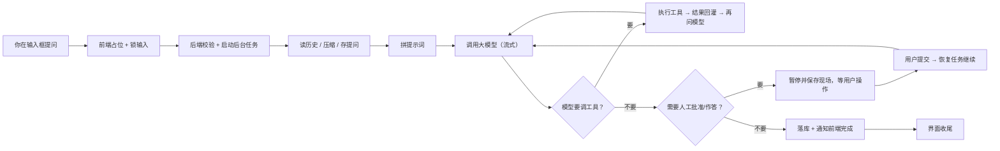
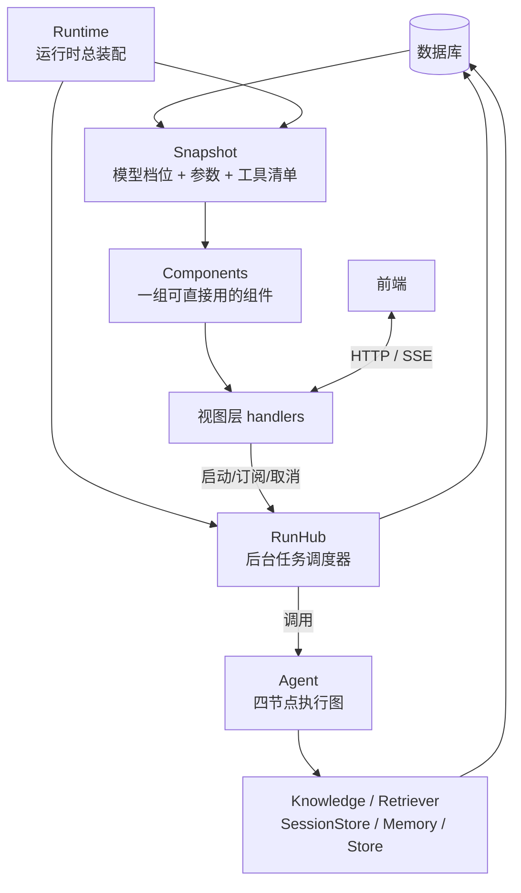
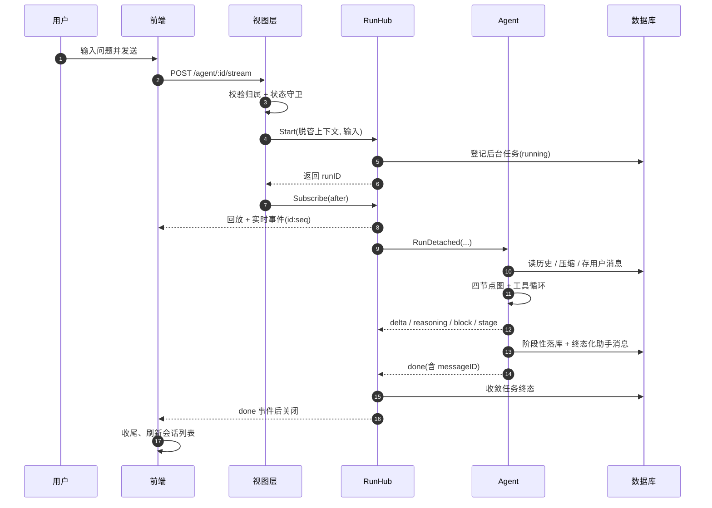
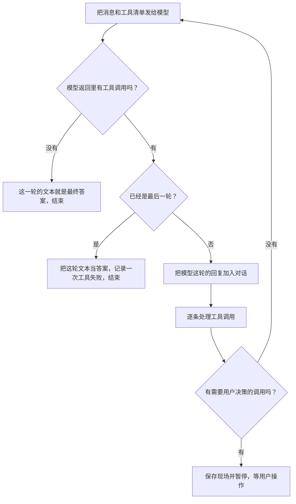
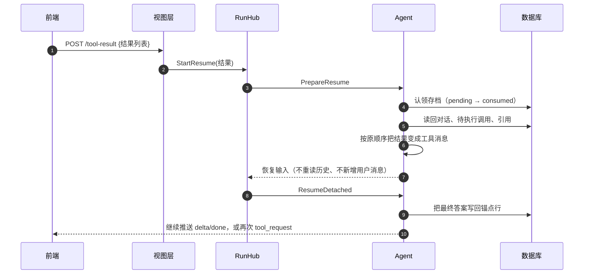
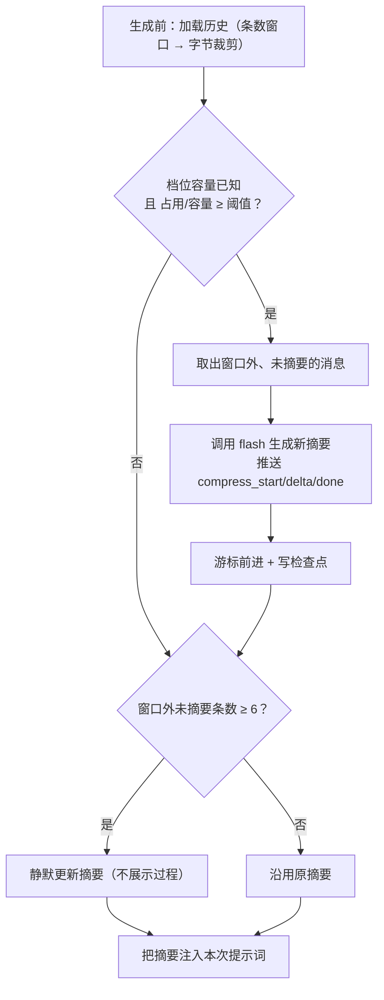
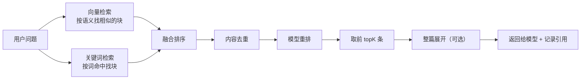
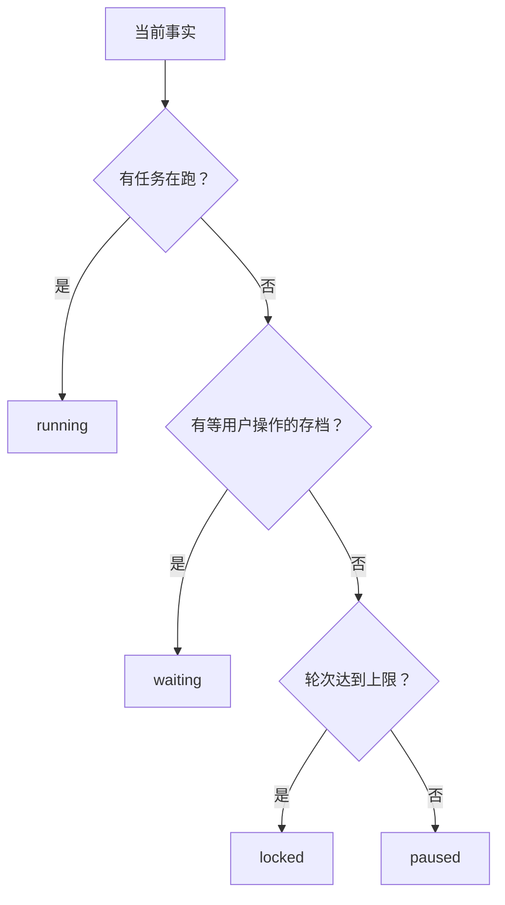

# AI Agent 功能架构详解

> 状态：已校对
> 责任人：@olinex
> 依据：`internal/ai`、`internal/manager/views/ai`

面向：刚接触本项目、或第一次维护 AI 助手功能的研发同学。
> 目标：读完之后，你能回答这三个问题——**一轮对话的数据存在哪、怎么流动、我改代码时不能破坏什么**。
> 说明：本文尽量用日常语言解释概念，专业词第一次出现时都会给出解释；需要精确字段和行号时，去第 11 章附录查。

## 0. 怎么读这篇文档

这篇文档不是 API 手册，而是一份「带地图的导览」。建议按你的目的选一条路线：

| 你的目的 | 建议阅读顺序 | 预计关注点 |
| --- | --- | --- |
| 只想搞懂它怎么跑起来的 | 第 1 章 → 第 2 章 → 第 5 章 | 故事、术语、一次提问的完整旅程 |
| 要改前端或对接 SSE | 第 2 章 → 第 5.5 节 → 第 9 章 | 事件类型、块的归并、交互状态 |
| 要改后端逻辑（工具、记忆、检索） | 第 2 章 → 第 4 章 → 第 6~8 章 → 第 10 章 | 数据结构、工具/审批、压缩、检索、不变量 |
| 只想查某个字段/枚举/参数 | 第 11 章附录 | 枚举、参数、索引、源码位置 |

读的时候如果遇到不认识的词，先翻回第 2 章的术语表，那里有比喻和「为什么需要它」。

---

## 1. 先建立直觉：一次提问到底发生了什么

先不看代码，想象一个场景：

> 你在页面右侧的助手抽屉里输入「帮我总结一下昨天那批告警的原因」，按下回车。

接下来系统做的事情，可以拆成 10 步：

1. **前端先占位**：界面上出现一个空的助手气泡，输入框被锁住，旁边显示「思考中」。
2. **请求到达后端**：后端先检查「这个会话是不是你的」「当前会话能不能发新问题」，然后**在后台启动一个任务**，而不是把这次生成绑在你这个浏览器连接上。
3. **任务开始跑**：后台任务先把「这个会话之前聊过什么」读出来，必要时把太长的旧对话压缩成摘要，再把这次提问存进数据库。
4. **拼提示词**：把系统提示、会话摘要、长期记忆、最近的历史消息、当前业务现场和你的提问，按固定顺序拼成一份「给模型看的材料」。
5. **问模型**：把材料发给大模型（可以理解为一次 HTTP 请求），模型开始一个字一个字地往回流。
6. **边收边推**：后台每收到一小段文字，就立刻通过一条长连接（SSE）推给浏览器，所以你看到的是「打字机效果」，而不是等全部生成完才出现。
7. **可能要调工具**：如果模型说「我需要查知识库」或「我需要算一下」，后台就去执行对应工具，把结果再塞回对话，让模型继续回答。这个过程可能来回好几轮。
8. **可能要问用户**：如果模型调用了「向用户提问」的工具，或者某次工具操作很危险需要你批准，后台会把这一轮**暂停**并保存现场，等你在界面上点「批准」或填完问卷。
9. **收尾落库**：回答生成完，后台把完整正文、引用来源、token 用量、耗时写进数据库，并通知前端「完成了」。
10. **界面收尾**：前端把流式过程中累积的内容替换成最终版本，解锁输入框，刷新左侧会话列表。

这 10 步里藏着本功能几乎所有设计难点：**浏览器会断、模型会慢、上下文会满、工具会失败、操作需要人批准**。后面的章节就是围绕这些难点展开的。



---

## 2. 术语与心智模型（先看这一章）

这一章把后面会反复出现的词一次讲清。每个词给三样东西：**一句话定义**、**一个生活比喻**、**为什么需要它**。

### 2.1 数据相关的词

| 术语 | 一句话定义 | 比喻 | 为什么需要它 |
| --- | --- | --- | --- |
| **会话（Session）** | 一次持续的多轮对话，有自己的标题、默认模型、摘要 | 一本聊天记录本 | 把同一话题的多轮问答归在一起，方便恢复上下文 |
| **消息（Message）** | 会话里的一条记录，角色是「用户」或「助手」 | 记录本里的一行 | 模型需要按顺序看到「你说了什么、我答了什么」 |
| **内容块（Block）** | 一条助手回答内部的「分段」，比如一段思考、一组工具调用、一张问卷、一段正文、一组推荐的下一步 | 一篇文章里的段落和小卡片 | 一轮回答里可能既有思考又有工具还有正文，用一个纯文本字段表达不了顺序和类型 |
| **序号（Seq）** | 消息在会话内的递增编号，从 1 开始 | 记录本的页码 | 排序、分页、找回「从第几页开始摘要」都靠它 |

**为什么要单独有「块」？** 因为一轮回答的真实结构是这样的：

```text
助手这条消息
├── 块 1：思考过程（reasoning）
├── 块 2：工具调用（tool_calls，可能包含同一轮的多个调用）
├── 块 3：等待批准（approval）或问卷（questionnaire）
├── 块 4：正文（content）
└── 块 5：推荐的下一步（next_steps，1-3 条，首条最推荐）
```

如果只存一段文本，刷新页面后就无法还原「先思考、再调工具、最后回答」的过程，也无法重新展示审批面板。块就是为「展示」而生的，**不参与喂给模型**（喂给模型的仍然是消息正文）。

### 2.2 运行相关的词

| 术语 | 一句话定义 | 比喻 | 为什么需要它 |
| --- | --- | --- | --- |
| **驻留运行（Live Run）** | 一次正在进行的生成任务，跑在后台 goroutine 里，不依赖浏览器连接 | 洗衣机：你关不关手机 App，衣服都在洗 | 用户关抽屉、刷新、断网时，不该白扔一次已经花了很多 token 的生成 |
| **运行现场（Agent Run）** | 任务被暂停时保存下来的「存档」：当时的对话、待执行的工具调用、检索引用、模型档位 | 游戏存档 | 等你批准或答完问卷后，从存档点继续，而不是从头再来 |
| **锚点消息（Anchor）** | 暂停时写下的那条助手消息，将来恢复后要把最终答案写回它 | 书里夹的书签 | 保证「一轮对话只对应一条助手消息」，不会出现一条半截 + 一条完整 |
| **SSE** | 一种「服务器持续往浏览器推消息」的长连接技术 | 广播电台：你打开就一直听 | 让模型生成的每个字都能实时显示，而不是等全部结束 |
| **事件序号（Seq）** | 一次运行内每个推送事件的递增编号 | 广播节目的期号 | 断线重连时告诉后端「我已经听到第 37 期，从 38 开始发」 |
| **退订宽限（Grace）** | 最后一个浏览器断开后，后台再等一段时间才取消任务 | 电梯门延时关闭 | 刷新页面只要在宽限内重连，任务就不会白取消 |
| **取消（Cancel）** | 用户主动停止，或宽限到点后系统自动停止 | 按洗衣机的停止键 | 避免没人看还在持续烧 token |
| **TTL** | 数据或登记的存活时间，过期会被清理任务删掉 | 超市的保质期 | 运行日志、暂停存档不能无限增长 |

### 2.3 模型与上下文相关的词

| 术语 | 一句话定义 | 比喻 | 为什么需要它 |
| --- | --- | --- | --- |
| **档位（Slot）** | 预先绑定好的模型档位，分 `flash`（快而便宜）、`standard`（默认）、`advanced`（强而贵）、`embedding`（向量化专用） | 车上的经济/标准/运动模式 | 不同任务用不同成本的模型，比如摘要用 flash、正式回答用 standard |
| **上下文窗口** | 模型一次最多能「看到」的 token 数量 | 桌子的面积 | 超出就放不下，必须裁剪或压缩 |
| **Token** | 模型计量的最小文本单位，中文大致 1 个字 ≈ 1~2 token | 字数 | 计费、限长、压缩阈值都按它算 |
| **滚动摘要** | 把「已经被挤出窗口的旧对话」写成一段简明摘要，后续只带摘要 | 会议纪要 | 既保留关键信息，又大幅减少上下文占用 |
| **长期记忆（Memory）** | 从对话里提炼出来、值得以后复用的稳定事实/偏好/决定/成果 | 便签墙 | 摘要会继续被压缩，记忆则是独立保存、按需召回 |
| **RAG** | 先检索资料，再让模型基于资料回答 | 开卷考试 | 让回答有依据、能引用，减少胡编 |
| **向量（Embedding）** | 把一段文字变成一串数字，意思相近的文字数字也相近 | 给每句话在语义空间里定一个坐标 | 支持「按意思找」，而不是只能按关键词找 |

### 2.4 工具与审批相关的词

| 术语 | 一句话定义 | 比喻 | 为什么需要它 |
| --- | --- | --- | --- |
| **工具（Tool）** | 模型可以主动调用的一个能力，比如查知识库、算数、查时间 | 给模型配的工具箱 | 模型本身不会算精确数学、也看不到你的知识库 |
| **工具循环** | 「模型说要调用 → 后台执行 → 结果回灌 → 模型继续」的反复过程 | 你问路，对方说「我看下地图」再回答 | 一次调用往往不够，需要多轮 |
| **内置工具（builtin）** | 本项目代码里实现、后端直接执行的工具 | 家里自带的工具 | 稳定、可控、无外部依赖 |
| **MCP 工具** | 通过标准协议连接的外部工具服务器提供的工具 | 叫外卖 | 复用外部能力，不用自己实现 |
| **client 工具** | 后端只描述「要做什么」，由前端在用户自己的环境/凭据下执行 | 让你自己去柜子里拿东西 | 后端拿不到用户的本地凭据或界面操作 |
| **执行归属（Exec Owner）** | 一次工具调用最终由谁执行：`client` 前端 / `backend` 后端 | 谁动手 | 决定暂停后谁来执行、结果怎么回传 |
| **审核重要级（Audit Level）** | AI 对一次工具调用「有多危险」的判断，分 `must`/`suggest`/`auto`/`none` | 风险等级 | 危险的自动拦下，安全的放行 |
| **审核阀门（Review Valve）** | 用户给整个会话设的「我有多想被询问」，分 `each`/`auto`/`none` | 手机的「询问我 / 自动允许」设置 | 同一个风险等级，不同用户想要不同的打扰程度 |
| **挂起（Suspend）** | 遇到需要用户决策的调用时，保存现场并结束本次推送 | 游戏暂停 | 等用户，而不是让模型干等或瞎猜 |

### 2.5 状态相关的词

| 术语 | 一句话定义 | 比喻 | 为什么需要它 |
| --- | --- | --- | --- |
| **交互状态** | 会话当前处于 `waiting`（等你操作）/`running`（后台在跑）/`paused`（空闲）/`locked`（轮次用尽） | 红绿灯 | 统一决定输入框能不能发、停止按钮能不能点、面板要不要弹 |
| **派生状态** | 不单独存数据库，而是每次用「现有事实」算出来的状态 | 根据体温计的读数判断是否发烧 | 避免状态列和真实情况不一致，回滚后能自动解锁 |
| **内容类事件** | 会改变界面内容的那些推送（正文、思考、工具、块、压缩过程） | 正在播放的节目 | 用户按下停止后，这些事件必须立刻停，不能继续冒出来 |

> 记住一句话：**「运行现场」是存档，「锚点」是存档对应的那条回答，「块」是回答的展示结构，「摘要/记忆」是压缩后的记忆体。**

---

## 3. 整体架构（谁负责什么）

### 3.1 四层结构

从浏览器到数据库，整个功能分四层。每一层只做一类事：

| 层 | 位置 | 负责什么 | 不负责什么 |
| --- | --- | --- | --- |
| 前端 | `web/src` | 渲染界面、发起请求、消费 SSE、把事件归并成消息和块 | 不判断业务是否允许、不决定用哪个模型 |
| 视图层（HTTP） | `internal/manager/views/ai` | 校验身份/命名空间/会话归属、做状态守卫、把请求翻译成领域调用、把结果翻译成出参 | 不写 Agent 逻辑、不直接拼 SQL |
| 领域层（运行时） | `internal/ai` | 装配模型和工具、执行四节点图、工具循环、挂起恢复、检索、压缩、记忆 | 不关心 HTTP 长什么样 |
| 基础设施 | PostgreSQL + pgvector、模型端点、远程 MCP | 存数据、跑模型、提供外部工具 | — |

### 3.2 抽象设计关系图

这张图回答「谁持有谁」：



用白话解释这张图：

- **Runtime** 是总装车间。它从数据库读「哪些模型可用、参数是多少、哪些工具启用」，组装成一份**只读快照**。配置变更（etcd 广播）时整体重建一份新快照替换旧快照，所以读取方永远拿到当前配置，不需要加锁。
- **Components** 是装配好的成品盒子（Agent、知识库、检索器、会话存储、记忆、参数、工具）。
- **RunHub** 是后台任务调度器。它不随配置重建而重建，所以正在跑的任务不会被热更新打断。它负责「登记任务、广播事件、断线回放、取消、超时清理」。
- **Agent** 是一次生成的具体执行者，内部是一张四节点的流水线图。
- **视图层** 只做「翻译 + 校验 + 守卫」，然后把活交给 RunHub。

### 3.3 为什么这样分层

| 设计 | 解决什么问题 |
| --- | --- |
| 运行与浏览器连接解耦 | 关抽屉、刷新、断网都不影响已经开始的生成；重连后还能接着看 |
| 配置用原子快照 | 改模型配置时不用停服，也不会读到一半新一半旧的配置 |
| 事件先广播、再异步落库 | 用户能最快看到内容；落库慢一点不影响体验 |
| 领域层不依赖 HTTP | 同一套 Agent 逻辑可以被视图层、worker、测试复用 |

### 3.4 文件地图（按「什么时候需要看」组织）

| 想看什么 | 去这些文件 |
| --- | --- |
| 一次生成怎么走、工具循环怎么转 | `internal/ai/agent.go` |
| 后台任务、事件广播、断线续播、取消 | `internal/ai/run_hub.go` |
| 暂停存档与恢复 | `internal/ai/agent_run.go` |
| 会话、消息、块、压缩检查点怎么存 | `internal/ai/session.go` |
| 块的结构和时序规则 | `internal/ai/blocks.go` |
| 交互状态怎么算、能不能操作 | `internal/ai/interaction.go` |
| 工具怎么装配（内置/MCP/client） | `internal/ai/store_tools.go`、`internal/ai/tools/`、`internal/ai/tools/mcp/` |
| 工具清单、提示词参数 | `internal/ai/params.go`、`internal/ai/tool_specs.go` |
| 审核重要级怎么评、怎么和阀门合成 | `internal/ai/audit.go` |
| 知识库入库与检索 | `internal/ai/knowledge.go`、`internal/ai/knowledge_tool.go` |
| 摘要、压缩、长期记忆 | `internal/ai/memory.go` |
| HTTP 接口 | `internal/manager/views/ai/register.go`（路由总表） |
| 前端流消费 | `web/src/apis/ai.ts`、`web/src/stores/agentRun.ts`、`web/src/components/ai/AssistantDrawer.vue` |
| 表结构 | `internal/migrations/core/001_init.sql` |
| 参数与工具出厂值 | `internal/migrations/core/002_fixtures.sql` |

---

## 4. 数据结构：到底有哪些东西被存下来

### 4.1 先看一轮对话在库里长什么样

假设你和助手聊了一轮，中间它查了一次知识库、又问了你一个问题。数据库里大致是这样：

```text
agent_sessions（1 行）
  标题="昨天告警原因"  默认档位=standard  审核阀门=each
  摘要="用户在做告警复盘，关注误报原因…"  已摘要到 seq=8
  │
  ├── agent_messages（第 9 行，role=user）
  │     正文="帮我总结一下昨天那批告警的原因"
  │
  └── agent_messages（第 10 行，role=assistant，phase=suspended）
        正文="我先查一下知识库。"
        ├── agent_message_blocks（block_seq=1, kind=reasoning）
        │     载荷={"text":"需要先确认告警分类…"}
        ├── agent_message_blocks（block_seq=2, kind=tool_calls）
        │     载荷={"calls":[{"toolName":"knowledge_search",...}]}
        └── agent_message_blocks（block_seq=3, kind=questionnaire）
              载荷={"questions":[...],"awaiting":true}
        │
        └── agent_session_compactions（若干行）
              记录每次摘要推进前的游标、摘要全文、折叠条数
```

这个例子体现了几条重要规则：

1. **一轮用户提问 + 一轮助手回答** 是两条 `agent_messages`，通过 `seq` 排序。
2. 助手回答内部的结构（思考、工具、问卷、正文、推荐下一步）拆成 `agent_message_blocks`，用 `block_seq` 排序。
3. 如果这一轮暂停等用户，助手消息的 `phase` 是 `suspended`，它同时是「锚点」。
4. 摘要不覆盖原消息，只在会话上记录「已经摘要到第几条」和摘要全文；每次推进还会留一个检查点，方便回滚。

### 4.2 核心表：先掌握这 8 张

| 表 | 它记录什么 | 什么时候写 | 什么时候删 |
| --- | --- | --- | --- |
| `agent_sessions` | 一个会话：标题、默认档位、Agent 类型、审核阀门、摘要、消息序号计数 | 创建会话、改标题/阀门、推进摘要 | 用户删会话（软删，同时清理子表） |
| `agent_messages` | 会话里的一条消息：角色、正文、草稿、引用、token、耗时、终态阶段 | 用户提问时、助手阶段落库/终态化时 | 回滚/截断时物理删除；删会话时级联删 |
| `agent_message_blocks` | 助手回答内部的有序块（思考/工具/审批/问卷/正文/推荐下一步） | 块创建与收敛时 | 随消息级联删 |
| `agent_session_compactions` | 每次摘要推进的检查点：推进到哪、摘要全文、折叠了几条、前后 token | 自动/手动压缩或静默滚动时 | 回滚时作废较晚的检查点；删会话时级联删 |
| `agent_runs` | **暂停存档**：暂停时的完整对话、待执行调用、引用、档位、锚点消息 ID、过期时间 | 需要人工决策而挂起时 | 恢复时置为已消费；过期后 TTL 清理 |
| `agent_live_runs` | **后台任务登记**：任务 ID、所属会话、当前阶段、已发到第几号事件、过期时间 | 任务启动时 | 任务收敛后保留一段时间，再 TTL 清理 |
| `agent_run_events` | **事件流水**：每个 SSE 事件的序号、类型、内容 | 每次推送事件时异步写 | TTL 清理 |
| `agent_memories` | 长期记忆：类别、标题、正文、向量、关键词索引、去重哈希 | `memory_write` 工具或压缩抽取时 | 用户归档/删除；删会话时硬删 |

另外 7 张表属于知识库和全局配置，见第 4.3 节。

### 4.3 另外 7 张表：知识库与全局配置

| 表 | 一句话说明 |
| --- | --- |
| `knowledge_documents` | 知识库文档：正文、内容指纹（判断索引是否过期）、分块数、处理状态 |
| `knowledge_chunks` | 文档切出来的小块：正文、向量、关键词索引，是检索的最小单位 |
| `llm_models` | 注册的模型端点：地址、密钥（加密）、模型名、上下文容量、思考开关配置 |
| `llm_bindings` | 档位到模型的绑定：`flash`/`standard`/`advanced`/`embedding` 各指向哪个模型 |
| `agent_params` | 行为参数：提示词、各种上限、阈值；`default_value` 是出厂值，`value` 是当前值 |
| `mcp_servers` | 远程 MCP 服务器：传输方式、地址、请求头（加密）、超时 |
| `llm_tools` | 工具注册表：工具名、来源（内置/MCP/前端）、是否启用 |

> 这 7 张表是**全局配置**，不按命名空间隔离；其他 AI 表都带「命名空间 + 用户」双重隔离。

### 4.4 三组最容易混淆的概念

初学者最容易在这三组上犯错，单独说明：

#### （1）后台任务登记 vs 暂停存档 vs 事件流水

| 你看到的名字 | 它回答的问题 | 类比 |
| --- | --- | --- |
| `agent_live_runs` | 「现在有没有任务在跑？跑到哪了？」 | 洗衣机的运行指示灯 |
| `agent_runs` | 「刚才那个任务暂停时是什么状态？怎么接着跑？」 | 游戏存档 |
| `agent_run_events` | 「断线前已经推送过哪些内容？重连后补哪些？」 | 广播节目的往期回放 |

三者的状态值也不同：`agent_live_runs.status` 用运行阶段（running/done/failed/cancelled/suspended）；`agent_runs.status` 用存档消费状态（pending/consumed/expired）。**不要混用。**

#### （2）消息 vs 块

- 消息是「喂给模型」的单位：模型只看到 `agent_messages.content`。
- 块是「给用户看」的单位：思考、工具、审批、问卷、正文的先后顺序。
- 所以：块的正文可以比消息正文更细；块不参与上下文回灌；删块不影响模型历史，删消息会连带删块。

#### （3）摘要 vs 长期记忆

| | 滚动摘要 | 长期记忆 |
| --- | --- | --- |
| 存在哪 | `agent_sessions.summary` | `agent_memories` 表 |
| 解决什么问题 | 上下文太长，放不下 | 有些信息值得跨轮次反复使用 |
| 怎么产生 | 被挤出窗口的旧消息自动/手动压缩 | 模型主动调 `memory_write`，或压缩时顺带抽取 |
| 可见范围 | 整个会话 | 仅来源会话内可见 |
| 会不会继续被压缩 | 会，摘要本身也会被再次合并 | 不会，独立保存 |

### 4.5 程序里最常打交道的几个对象

不必记住所有字段，先理解它们各自代表什么：

| 对象 | 代表什么 | 关键内容 |
| --- | --- | --- |
| `AgentInput` | 「这次运行要做什么」 | 提问、命名空间、文档范围、会话/用户、历史、摘要、业务现场、档位；还有一些只内部用的注入项（上报回调、恢复消息链、块构建器） |
| `AgentState` | 「这张图跑到一半时的共享便签」 | 输入、检索采集器、档位、回调、恢复链、是否已挂起 |
| `AgentOutput` | 「流里的一项」 | 增量正文 / 思考增量 / 最终完成项（完整正文、引用、草稿、用量、消息 ID） |
| `ToolRequest` | 「请前端执行的调用」 | 调用 ID、工具名、参数、风险等级、是否需审批、谁执行、锚点消息 ID |
| `ToolResult` | 「前端执行完回传的结果」 | 调用 ID、是否批准、结果或错误 |
| `StageEvent` | 「某个阶段的进度」 | 阶段名、状态、耗时、工具名、调用 ID、轮次 |
| `blockBuilder` | 「块的书签管理器」 | 当前开放块、下一个块序号、待落库/待推送的块 |

### 4.6 事件与块长什么样（前端同学重点）

**六类块**（`kind` 的取值）：

| 块类型 | 里面装什么 | 什么时候产生 |
| --- | --- | --- |
| `reasoning` | `{"text": "..."}` 思考文本 | 模型开始输出思考时开块 |
| `content` | `{"text": "..."}` 正文文本 | 模型开始输出正文时开块 |
| `tool_calls` | `{"calls": [...]}` 同一轮的调用记录 | 模型发起工具调用时 |
| `approval` | `{"calls": [...]}` 待用户批准的调用清单 | 因危险操作暂停时 |
| `questionnaire` | `{"questions": [...], "answers": [...], "awaiting": bool}` | 模型调用 `ask_user` 时 |
| `next_steps` | `{"steps": [{"title": "...", "reason": "...", "text": "...", "recommended": bool}]}` | 回答完成后生成 1-3 条推荐的下一步时 |

**SSE 事件**（`event:` 行的取值）：

| 事件 | 作用 | 数据大致长什么样 |
| --- | --- | --- |
| `delta` | 正文增量 | `{"delta":"你好"}` |
| `reasoning` | 思考增量 | `{"delta":"让我想想…"}` |
| `stage` | 阶段进度（检索、工具调用等） | 阶段名、状态、耗时、工具名 |
| `block` | 块创建或收敛 | `{seq, kind, payload, created}` |
| `tool_request` | 请前端执行/审批 | 调用 ID、工具名、参数、风险等级、锚点 ID |
| `state` | 交互状态变化 | `{state, substate}` |
| `compress_start` / `compress_delta` / `compress_done` | 上下文压缩的过程 | 压缩原因、前后 token、折叠条数、摘要增量 |
| `done` | 最终完成 | 完整正文、引用、用量、耗时、消息 ID |
| `error` | 运行失败/被取消 | 错误文本 + 终态阶段 |
| `ping` | 心跳保活 | 无数据 |

前端处理这些事件的规则见 5.5 节。

### 4.7 数据安全：为什么有些字段看起来是乱码

含用户内容或凭据的列（消息正文、摘要、引用、工具参数、API Key、MCP 请求头等）都以**加密后的二进制**存储。数据库里直接查出来是乱码，这是正常的。

两个容易踩的坑：

1. **写加密列必须用「结构体 + `Select` 字段」的方式**，不能用 `map[string]any` 更新。后者会绕过加密序列化器，把明文直接写进库。
2. **不要试图在 SQL 里直接比较或模糊搜索加密列**（比如 `LIKE '%关键词%'`），它们没有明文可查。关键词检索用的是另外的 `tsvector` 列。

精确的加密列清单和密钥偏移见附录 11.3。

---

## 5. 数据流转（一）：一次提问的主流程

### 5.1 白话版

1. 前端调用 `POST /ai/agent/:sessionID/stream`，同时打开 SSE 长连接。
2. 视图层依次检查：命名空间、会话是不是当前用户的、当前状态能不能发新问题。
3. 视图层调用 `RunHub.Start` 启动后台任务，然后立刻订阅这个任务的事件并转发给浏览器。
4. 后台任务执行 `Agent.StreamRun`：
   - 校验会话、读取最近历史（先按条数，再按字节裁剪）；
   - 如果上下文快满了，先自动压缩；
   - 把用户这次提问存库；
   - 创建块构建器和暂停共享状态；
   - 进入四节点图。
5. 四节点图依次做：整理输入 → 清洗业务数据并拼消息 → 调模型（可能带工具循环）→ 解析输出并校验。
6. 流式结果经过一层「落库包装」：边推给前端，边按需阶段性写库，最后终态化。
7. 任务结束后，RunHub 把状态收敛为 done/failed/cancelled/suspended，写入终态并关闭订阅。

### 5.2 时序图



### 5.3 四节点各自在干什么

| 节点 | 白话解释 | 为什么需要单独一步 |
| --- | --- | --- |
| ① 上下文装配 | 检查提问不为空，把这次运行的所有参数记到「共享便签」上 | 后面节点都要读这些参数，集中放一次 |
| ② 业务数据清洗 + 拼消息 | 把前端传来的业务现场去掉空值、限制大小，再按固定顺序拼出给模型的消息列表 | 业务现场可能很大很脏，直接塞给模型会浪费上下文 |
| ③ 模型生成 | 选模型、发请求、处理工具调用循环 | 这是唯一真正和模型交互的地方 |
| ④ 输出校验 | 把流式片段拼成完整回答，尝试解析结构化结果，必要时跑 Rego 规则校验 | 模型输出不一定符合格式，需要兜底 |

**恢复运行有个特殊捷径**：如果是「暂停后继续」，节点 ② 不重新清洗业务数据、不重新召回记忆，而是直接使用暂停时保存的消息链。这样避免上下文「漂移」（同样的输入两次得到不同的上下文）。

### 5.4 给模型的消息是按什么顺序拼的

```text
[系统] 系统提示词
[系统] "## 会话摘要" + 摘要内容            ← 有摘要时
[系统] "## 长期记忆" + 若干条记忆           ← 有记忆时
[用户] 较早的历史消息
[助手] ...
[用户] 较新的历史消息
[用户] "## 当前业务现场" + JSON
       "## 用户提问" + 你的问题
```

几个要点：

- **业务现场和提问拼在同一条用户消息里**，不是拆成两条。这样消息条数更少，模型也更容易把「现场」和「问题」联系起来。
- **摘要和记忆放在系统消息里**，位于历史之前，相当于「背景资料」。
- 系统提示词按 Agent 类型选择：`general` 用纯 Markdown 提示词，其他类型用要求输出 JSON 信封的提示词。
- 历史消息的窗口由两个参数控制：最多多少条（默认 20）、最多多少字节（默认 32KB）。字节超了就从最旧的开始整条丢弃，至少保留最新一条。

### 5.5 前端怎么把事件变成界面

前端不自己猜「是不是在运行」，而是**完全听后端的**：

| 收到的事件 | 前端做什么 |
| --- | --- |
| 任意带 `id:` 的事件 | 记下序号并持久化，作为断线重连的 `after` 参数 |
| `state` | 更新交互状态，驱动输入框、停止按钮、面板、状态提示 |
| `block` 且 `created=true` | 建一个空块占位；如果是思考/正文，把它记为「当前开放块」 |
| `block` 且 `created=false` | 用载荷里的全文覆盖这个块（收敛） |
| `delta` | 追加到当前 `content` 块和消息正文 |
| `reasoning` | 追加到当前 `reasoning` 块 |
| `tool_request` | 记录待执行调用（按调用 ID 去重），弹出审批或问卷面板 |
| `compress_*` | 在当前助手消息上展示「正在压缩/压缩完成」 |
| `done` | 用最终正文覆盖，回填引用、用量、耗时、消息 ID |
| `error` | 标记本轮失败/取消，显示中断提示 |
| 连接正常结束 | 若有待审批调用，判断是否可以自动统一提交；并投递排队中的下一条提问 |

**为什么要区分「创建」和「收敛」？** 因为思考/正文是持续增长的：创建时只带第一小段，后面靠 `delta`/`reasoning` 不断追加；收敛时载荷变成全文，用它覆盖即可。如果创建时也用全文覆盖，回放时就会和已经追加的文本重复。

### 5.6 落库与推送的先后关系

一句话：**先让用户看到，再写数据库。**

- 每产生一段增量，先推给前端，再累积到内存缓冲。
- 累积到 2048 字节（正文 + 思考合计）才写一次库，避免每个字都写库。
- 第一次写库时新建助手消息行，拿到行 ID；之后都更新这同一行。
- 生成完成时：先把块收敛并写库，再把助手消息终态化为 `done`，最后才把 `done` 事件推给前端（保证「库里的值」和「推送的值」一致）。
- 如果中途失败/取消：先把已产出的内容写库，并把阶段标成 `failed`/`cancelled`，再推错误事件。这样刷新后仍能看到中断前的半截内容。
- 写库用的上下文刻意「剥离了取消和超时」，否则一旦超时，最需要保存的时候反而写不进去。

---

## 6. 数据流转（二）：工具调用与人工审批

### 6.1 三类工具，用生活场景理解

| 类型 | 谁执行 | 例子 | 什么时候需要用户参与 |
| --- | --- | --- | --- |
| 内置（builtin） | 后端 | 查知识库、算数、解方程、查时间、JSON 处理 | 一般不需要；只有被判定为「危险」时才需要批准 |
| MCP | 后端（通过远程 MCP 服务器） | 外部系统提供的工具 | 同上 |
| client | 前端（用户自己的环境/凭据） | 向用户提问 `ask_user` | 一律需要（要么批准执行，要么填问卷） |

### 6.2 工具循环：一个来回不够就再来一轮



每轮里，工具调用的处理规则是：

- **内置/MCP 工具**：直接执行。成功就把结果（按 32KB 截断）塞回对话；失败就把错误文本塞回对话，让模型自己纠正。**工具失败不会让整轮报错**。
- **client 工具**：不在这里执行，登记为「等待前端处理」。
- **达到轮数上限（默认 10）还有没完成的调用**：把这一轮文本当答案，记录一次失败，不报错。
- **思考内容不回灌**：模型这轮的思考过程只推给用户看，不塞回下一轮上下文（很多模型供应商也明确要求不要回传）。

### 6.3 什么时候会暂停

只有三种情况会暂停：

1. **client 工具调用**：有持久化会话且具备审批通道时，一律暂停等前端执行。
2. **内置/MCP 工具被评估为 `must`（必须审核）**：暂停等用户批准，批准后由后端执行。
3. **`ask_user` 问卷**：暂停等用户作答（它本身也是 client 工具，但不需要审批）。

如果**没有会话**或**没有审批通道**（比如某些内部调用），client 工具不会暂停，而是直接把「这个调用无法执行」作为工具结果回灌给模型，让它换个方式回答。

### 6.4 风险等级 × 审核阀门：两个开关怎么配合

- **风险等级（重要级）** 是 AI 对这次调用危险程度的判断，四档：`must`（必须问）、`suggest`（建议问）、`auto`（可自动）、`none`（无需问）。
- **审核阀门** 是用户在会话级设置的三档：`each`（每次都要问我）、`auto`（只问比较危险的）、`none`（尽量别问我）。

合成规则（「人工」= 需要用户批准）：

| 风险等级 \ 阀门 | `each` | `auto` | `none` |
| --- | --- | --- | --- |
| `must` | 人工 | 人工 | 人工 |
| `suggest` | 人工 | 人工 | 自动 |
| `auto` | 人工 | 自动 | 自动 |
| `none` | 人工 | 自动 | 自动 |

记忆方法：**`must` 永远要问；`each` 永远要问；其余看阀门和等级的交叉。**

补充几个实现细节：

- 风险等级是**一次批量评估**得出的：把所有待执行调用一起发给一个便宜的模型（优先 `flash`），让它返回每条的等级。
- 评估失败、返回空、解析失败、条数对不上时，**全部按 `must` 处理**（保守策略：宁可多问，不可误放行）。
- 评估会带上工具名、工具用途说明和参数原文，帮助模型判断副作用。
- 问卷类调用**跳过评估**，直接视为无需审批。

### 6.5 暂停时到底保存了什么

暂停不是「把线程挂起」，而是「存档后结束本次推送」。存档（`agent_runs`）里有四样关键东西：

1. **当时的完整对话消息链**：恢复时直接从这里继续。
2. **待执行的工具调用列表**：调用 ID、工具名、参数、谁执行、风险等级、第几轮。
3. **已经检索到的引用**：恢复后最终答案仍要带上这些引用。
4. **锚点消息 ID**：暂停时写下的那条助手消息，恢复后要把最终答案写回它。

此外还会做两件事：

- 把这一轮已经推给用户的正文，写进锚点消息，并把阶段标成 `suspended`。
- 把 pending 的调用逐个推给前端（这条推送会带上锚点消息 ID），前端据此把面板挂到正确的消息上。

> 特殊规则：**问卷暂停保留锚点行；其他暂停会删掉阶段性落库的那一行。** 因为问卷需要在界面上持续显示题目和作答；其他暂停属于「还没答完」，恢复后会把已推的正文并回最终答案，留着会产生两条半截助手消息。

### 6.6 用户操作后如何恢复



几个容易忽略的点：

- **存档有 10 分钟有效期**。超过时间会返回「已过期」。
- **存档只能被消费一次**。并发重复提交时，只有一方能认领成功。
- **恢复也是一次独立的后台任务**，有自己的登记和终态，否则前端刷新后会一直显示「仍在等待审批」。
- **恢复时后端会自己执行已批准的 backend 工具**；client 工具则使用前端回传的结果（用户拒绝或前端执行失败时，回灌固定的拒绝/错误文案）。
- 恢复后的最终答案**原地写回锚点行**，不新增一行。

### 6.7 问卷（ask_user）特殊在哪

- **只提问，无副作用**：所以跳过风险审核，不需要批准。
- **可以多轮**：模型可能在拿到上一轮答案后继续问下一轮，每一轮各成一个问卷块。
- **同轮多题会合并**：模型一轮里调用多次 `ask_user`，题目合并成一张问卷；但如果题目 ID 重复，这条调用会被当作失败回灌，让模型改。
- **答案并入末轮**：恢复时只把本次答案并入最后一轮，之前各轮的答案保留，避免刷新后变回「未作答」。
- **用户取消**：前端回传「未批准 + 无答案」，末轮答案会被清空，回到未作答状态。

---

## 7. 数据流转（三）：上下文太长怎么办

### 7.1 问题是什么

模型一次能看的 token 有限（比如 32K、128K）。对话越聊越长，最终会：

- 放不下 → 请求报错；
- 放得下但很贵、很慢；
- 关键信息被淹没。

所以系统有三道防线：

| 防线 | 触发时机 | 做什么 | 用户看得见吗 |
| --- | --- | --- | --- |
| ① 窗口裁剪 | 每次生成前 | 只取最近 N 条消息，再按字节预算从最旧整条丢弃 | 看不见 |
| ② 自动压缩 | 占用 / 容量 ≥ 阈值（默认 80%） | 把「窗口之外、还没被摘要」的消息折叠进滚动摘要，写入检查点 | 看得见（压缩过程事件） |
| ③ 静默滚动摘要 | 挤出去的消息 ≥ 阈值（默认 6 条） | 悄悄更新摘要，不展示过程 | 看不见 |

另外用户还可以在界面上**手动压缩**，指定「压缩到哪条消息为止」。

### 7.2 压缩到底做了什么

```text
压缩前： [摘要 S0] + [消息 1..30] + [最近窗口 31..50]
                    ↑ 这些已经挤出窗口
压缩后： [新摘要 S1 = S0 + 消息 1..30 的要点] + [最近窗口 31..50]
```

- 新摘要由模型（默认 `flash` 档位）生成，可以流式展示生成过程。
- 摘要推进后，会话上记录「已摘要到第 30 条」（游标），下次不再重复折叠。
- 同时写一条**压缩检查点**：记录游标、摘要全文、折叠条数、压缩前后 token。检查点的作用是「回滚」：如果你删掉了包含压缩内容的某一轮对话，系统可以把摘要回退到更早的检查点，避免摘要里还留着已删除的内容。

### 7.3 压缩流程图



### 7.4 占用的 token 数从哪来

- **真实测量**：每次模型调用后，供应商会返回这次请求用了多少输入 token。系统把它记在助手消息上。取「最近一条有记录的助手消息」的值作为当前占用。
- **0 的含义**：0 表示「还没有任何一次真实测量」，不是「占用为 0」。例如会话唯一一次回答被取消了，就没有测量值。
- **压缩后的即时估算**：压缩完成后马上要展示「压缩后大概多少」，此时还没有新的真实测量，所以用估算：
  - 优先用摘要模型自己报告的 token 数算；
  - 算不出来就按字节粗略折算；
  - 都不行就不展示。
- **展示口径**：取「最近一次真实测量」和「最近一次压缩估算」里更晚发生的那个。真实测量一旦到达，就覆盖估算。

### 7.5 压缩失败会怎样

**不会中断生成。** 失败时只记告警，保留旧摘要，游标不前进，并推一个「折叠 0 条」的完成事件。原因很简单：压缩是优化，不应该因为优化失败就毁掉一整轮已经花了很多钱的模型调用。

### 7.6 长期记忆：和摘要有什么不同

| | 滚动摘要 | 长期记忆 |
| --- | --- | --- |
| 目标 | 让上下文放得下 | 让有价值的信息以后还能用 |
| 触发 | 自动/手动压缩 | 模型主动写入，或压缩时顺带抽取 |
| 内容 | 整段对话的压缩叙述 | 一条条独立的事实/偏好/决定/成果 |
| 检索 | 不检索，直接整段注入 | 按当前问题做混合检索，取最相关的几条 |
| 隔离 | 会话内 | 命名空间 + 用户 + Agent 类型 + **来源会话** |

#### 记忆的生命周期

1. 模型在对话中觉得某条信息值得记住，调用 `memory_write`。
2. 写入时先做精确去重（内容指纹），再做语义合并（意思太像的就合并），都不命中才新增。
3. 下次生成前，系统用当前问题去检索记忆（向量 + 关键词），取最相关的几条注入提示词。
4. 记忆只在来源会话内可见；用户可以在记忆管理页查看、归档、删除。

> 记忆召回失败、记忆开关关闭、没有会话时，都只是「不注入记忆」，不会报错。

---

## 8. 数据流转（四）：知识库检索（RAG）

### 8.1 为什么要 RAG

模型的知识停留在训练数据里，不知道你的内部文档。RAG（Retrieval-Augmented Generation）的思路是：**先去你的知识库找相关片段，再把片段和问题一起交给模型**。这样回答有依据，还能给出引用。

### 8.2 入库：文档是怎么变成可检索的

```text
上传/创建的文档
   → 按 Markdown 标题层级切块（默认每块 800 字，块间重叠 100 字）
   → 每块拼上「标题路径 + 正文」作为索引文本
   → 批量调用 embedding 模型，把每块变成一串数字（向量）
   → 一个事务里：删掉旧块 → 写入新块（正文加密、向量、关键词索引）
   → 更新文档的分块数和内容指纹
```

**内容指纹**（HMAC-SHA256）用来判断「文档正文改了但索引没重建」：如果指纹和当前正文算出来的不一致，说明索引过期，需要重建。

### 8.3 检索：两条路并行，再合并



每一步用白话解释：

| 步骤 | 在做什么 | 为什么需要 |
| --- | --- | --- |
| 向量检索 | 把问题也变成向量，找距离最近的块 | 能处理「说法不同但意思相近」 |
| 关键词检索 | 用数据库全文索引找包含这些词的块 | 能精确命中编号、专有名词、错误码 |
| 融合 | 把两路结果按名次或权重合成一个排序 | 两路各有盲区，合起来更稳 |
| 内容去重 | 如果两个块内容几乎一样（4-gram 相似度 ≥ 0.8），只留靠前的 | 重复块会挤掉真正有用的候选 |
| 模型重排 | 让一个便宜模型给候选块重新打分排序 | 初步召回追求「全」，重排追求「准」 |
| 取 topK | 默认只保留 5 条 | 控制上下文成本 |
| 整篇展开 | 命中的块所属文档整篇带进结果（有总长度上限） | 分块可能丢掉上下文，整篇更完整 |

### 8.4 引用是怎么回到界面的

每执行一次 `knowledge_search`，检索到的结果会同时做两件事：

1. 转成工具结果返回给模型（模型据此写答案）。
2. 塞进一个「本次运行的引用收集器」。

生成结束时，收集器里的结果会作为 `Citations` 放进 `done` 事件，前端据此在回答下方展示来源。恢复运行时，暂停前收集到的引用会先预置回收集器，保证最终答案的引用不丢。

### 8.5 检索范围由谁决定

模型调用 `knowledge_search` 时**只能传一个问题**。命名空间、限定文档、topK 这些都不由模型决定，而是由本次运行的上下文固定注入。这是为了安全：**不能让模型自己选择租户范围**。

---

## 9. 状态、断线与异常处理

### 9.1 交互状态：四个状态决定界面能做什么

| 状态 | 什么情况 | 界面表现 | 能做什么 |
| --- | --- | --- | --- |
| `running` | 后台有任务在跑（生成或压缩） | 显示「思考中/生成中/调用工具中/压缩中」 | 可以停止；不能发新问题 |
| `waiting` | 在等你操作（批准或填问卷） | 弹出审批/问卷面板 | 可以提交、取消；不能发新问题 |
| `paused` | 空闲，最近一轮已结束 | 正常输入框 | 可以发新问题、回滚、压缩、回退重开 |
| `locked` | 有效提问轮次达到上限（默认 20） | 提示已达上限 | 不能发新问题；回滚后轮次下降会自动解锁 |



**为什么状态不存数据库？** 因为它是「算出来的」：只要有任务就是 running，只要有存档就是 waiting，轮次够了就是 locked。这样不会出现「数据库说空闲但实际在跑」的矛盾；回滚删掉几条提问后，轮次自然下降，状态自动回到 paused，不需要额外的「解锁」代码。

### 9.2 断线了会怎样

| 场景 | 系统行为 |
| --- | --- |
| 关闭抽屉 / 刷新 / 断网 | 只是「退订」，后台任务继续跑 |
| 宽限期内重连 | 从你最后收到的事件序号之后继续推，不重复、不缺失 |
| 宽限期（默认 90 秒）过了还没人看 | 自动取消任务，避免继续烧 token |
| 刷新后想恢复界面 | 前端查询「在途运行快照」，拿到当前阶段、待审批调用，再续播 |
| 进程重启 | 数据库里的 running 登记变成「孤儿」，下一次读取状态时会被收敛为 failed，不会永远转圈 |
| 存档过期 | 返回「已过期」，前端提示重新发起 |

### 9.3 取消的三种情况

1. **运行中**：取消后台任务的根上下文，等待它真正退出后才返回。返回之后保证不会再有正文事件冒出来。
2. **等待中**（后端已经没有生成任务）：作废存档，把锚点消息标成「已取消」。
3. **暂停/已锁定**：没有任务可取消，幂等返回成功。

### 9.4 截断、分支、回退重开：三个容易混的操作

| 操作 | 用户想干什么 | 系统做什么 |
| --- | --- | --- |
| 截断（回退到某轮） | 「后面几轮不要了，从这个提问重新开始」 | 删除该提问及其后的所有消息和块；相关存档作废；如果删除的内容已被摘要覆盖，按检查点回退摘要 |
| 分支 | 「保留现有对话，但从这里分出一条新线」 | 新建一个会话，把该轮及之前的消息复制过去（序号重排），原会话不动 |
| 回退重开 | 「上次那个问卷/审批我想重新答」 | 删除锚点之后的内容，把问卷/审批块重置为待输入，存档重置为 pending，然后等用户重新提交 |

共同点：它们都只在 `paused` 或 `locked` 状态允许执行（避免和正在跑的任务打架）。

### 9.5 出错了会怎样（降级策略）

这套系统的总体原则是：**增强能力失败，不能拖垮主流程。**

| 出问题的环节 | 系统的处理 |
| --- | --- |
| 长期记忆召回失败 | 不注入记忆，只记日志 |
| 摘要/压缩失败 | 保留旧摘要，不推进游标，继续生成 |
| 块写库失败 | 只记日志（块只是展示，不影响回答） |
| 阶段性落库失败 | 只记日志，继续生成 |
| 工具执行失败 | 把错误文本作为工具结果回灌，让模型自己纠正 |
| 工具结果太长 | 按 32KB 截断（不会切断多字节字符） |
| 风险等级评估失败 | 全部按「必须审核」处理 |
| 单个 MCP 服务器连不上 | 跳过它的工具，其他工具照常可用 |
| 重排模型失败 | 退回融合排序 |
| 结构化输出解析失败 | 把原文当普通正文返回 |
| Rego 校验规则报错 | 视为校验不通过并给出说明，不中断会话 |
| 压缩后的 token 估算失败 | 不展示估算值，等真实测量 |

---

## 10. 改代码前必须知道的事

### 10.1 七条不变量（违反了会出 bug）

| # | 不变量 | 违反了会怎样 |
| --- | --- | --- |
| 1 | 一个会话同一时刻最多一个在途任务（生成/续跑/手动压缩） | 两个任务同时写同一会话，消息顺序和状态会乱 |
| 2 | 一轮对话只有一条助手消息 | 刷新后出现「半截回答 + 完整回答」两条气泡 |
| 3 | 同一消息内块序号唯一且递增 | 块覆盖错位、前端渲染重复或丢块 |
| 4 | 消息序号 `(会话, 用户, seq)` 唯一，回滚不复用序号 | 历史排序错乱、摘要游标指错消息 |
| 5 | 事件序号单调，断线按 `after` 续播 | 重连后重复或漏事件 |
| 6 | 取消生效后不再下发任何内容类事件 | 用户点了停止，界面还在继续冒字 |
| 7 | 配置读取不会 panic；只有参数键缺失才是编程错误 | 启动期崩溃，或静默读到错误配置 |

### 10.2 并发与生命周期要点

- **两把锁不要同时持有**：RunHub 的 map 锁和单个任务的锁是分开的，先定位、放锁、再操作任务。
- **上报状态时不要在持锁状态下发布事件**：发布内部还会拿同一把锁，会死锁。
- **慢订阅者会被丢事件**：订阅者通道满了就丢弃，绝不阻塞生成。靠「回放 + 数据库补齐」保证最终一致。
- **两套上下文别混用**：
  - 运行上下文：带取消和 30 分钟上限，管执行和推送；
  - 落库上下文：剥离取消和超时，只管写库，保证中断时也能保存。
- **视图层不能把 `*gin.Context` 带进后台 goroutine**：handler 返回后它就不能用了，必须提前抽出普通 `context.Context`。
- **关闭顺序**：先停清理任务 → 关 RunHub（取消在途并等终态落库）→ 关 MCP 连接 → 关配置监听。

### 10.3 扩展点：新增东西要改哪几处

| 你要新增 | 必改位置 | 有守卫测试吗 |
| --- | --- | --- |
| 内置工具 | ① `internal/ai/tool_specs.go` 登记名字和分组；② `internal/ai/tools/` 里实现并 `Register`；③ `002_fixtures.sql` 加出厂行 | 有，三处不一致会失败 |
| client 工具 | ① `ToolSpecs`；② `internal/ai/client_tools.go` 的 schema 注册表；③ fixture | 有 |
| 行为参数 | ① `internal/ai/params.go` 的 `Specs`；② fixture 出厂值；③ 两份语言文件的 label/comment | 启动期强校验 + i18n 完整性测试 |
| 枚举 | 在所属包调用 `enum.Register` | 有 |
| 内容块类型 | 枚举清单 + 载荷结构 + 构建方法 + 前端渲染 | 有 |
| SSE 事件类型 | 事件枚举 + `sse` 常量 + 前端分发 | 有事件名映射测试 |
| MCP 服务器 | 管理端登记服务器 + 同步工具行 | — |

### 10.4 最容易踩的五个坑

1. **用 `map` 更新加密列** → 明文入库。必须用「结构体 + `Select`」。
2. **新增工具只改了两处** → 启动/测试会报注册表漂移。记住「元信息、实现、出厂行」三处同步。
3. **新增事件只在后端加** → 前端不认识，界面没反应；或者只在前端加，后端永远不发。
4. **在参数注册表里漏了 key** → 读取时直接 panic（这是故意的 fail fast，不是 bug）。
5. **在事务外做「先删后插」** → 中途失败会留下半套数据。消息、块、检查点的批量操作都要放在事务里。

---

## 11. 附录（查表用）

### 11.1 枚举清单

| 枚举类 | 取值 | 为什么会有它 |
| --- | --- | --- |
| `knowledgeDocStatus` | `pending` / `parsing` / `ready` / `failed` | 文档导入是异步的，需要表达「还没好」 |
| `agentKind` | `general` / `knowledge` / `rego` | 不同场景用不同提示词、不同记忆范围 |
| `agentRunStatus` | `pending` / `consumed` / `expired` | 存档只能被恢复一次，需要表达消费状态 |
| `agentRunPhase` | `running` / `done` / `failed` / `cancelled` / `suspended` | 描述一次任务的生命周期 |
| `agentInteractionState` | `waiting` / `running` / `paused` / `locked` | 统一驱动界面的可用性 |
| `agentInteractionSubstate` | `approval` / `answer` / `generating` / `thinking` / `tool_calling` / `compacting` / `success` / `failed` / `aborted` | 让用户知道「具体在等什么/在做什么」 |
| `agentRunEventType` | `delta` / `reasoning` / `stage` / `tool_request` / `compress_start` / `compress_delta` / `compress_done` / `done` / `error` / `state` / `block` | SSE 事件类型 |
| `agentMessageBlockKind` | `reasoning` / `tool_calls` / `approval` / `questionnaire` / `content` / `next_steps` | 回答内部的分段类型 |
| `sessionStatus` | `active` / `archived` | 会话列表只展示活跃会话 |
| `messageRole` | `user` / `assistant` / `system` | 区分消息是谁说的 |
| `memoryKind` | `fact` / `preference` / `decision` / `artifact` | 便于分类展示和检索 |
| `memoryStatus` | `active` / `archived` | 归档的记忆不参与召回 |
| `toolSource` | `builtin` / `mcp` / `client` | 决定工具怎么装配、由谁执行 |
| `llmSlot` | `flash` / `standard` / `advanced` / `embedding` | 不同任务用不同成本的模型 |
| `reviewValve` | `each` / `auto` / `none` | 用户对「被打扰程度」的偏好 |
| `auditLevel` | `must` / `suggest` / `auto` / `none` | AI 对单次操作危险程度的判断 |
| `evalStage` | `retrieve` / `answer` / `chunkRelevance` / `claims` / `reverseQuestions` / `suggestions` / `toolCall` / `toolResult` | 评估和工具阶段的名字 |
| `evalStageStatus` | `start` / `done` / `failed` | 阶段进度 |
| `diagnosisCategory` | `coverage` / `ranking` / `generation` / `context` / `other` | 改进建议的分类 |
| `mcpTransport` | `streamable_http` / `sse` | 连接远程 MCP 的方式 |
| `ToolExecOwner` | `client` / `backend` | 暂停后谁执行 |

### 11.2 行为参数清单（默认值）

所有值存在 `agent_params.value`，出厂值在 `default_value`。下列默认值来自 `002_fixtures.sql`。

#### agent 组

| Key | 默认 | 含义 |
| --- | --- | --- |
| `agent.systemPrompt` | fixture | 非 general 类型的系统提示词（要求输出 JSON 信封） |
| `agent.generalSystemPrompt` | fixture | general 类型的系统提示词（纯 Markdown） |
| `agent.auditLevelSystemPrompt` | fixture | 风险等级评估提示词 |
| `agent.promptOptimizeSystemPrompt` | fixture | 提问改写提示词 |
| `agent.businessSectionTitle` | `## 当前业务现场` | 业务现场段标题 |
| `agent.questionSectionTitle` | `## 用户提问` | 提问段标题 |
| `agent.retrievedDocSnippetLimit` | 500 | 单条检索命中截断长度（字符） |
| `agent.defaultSlot` | `standard` | 三级档位回退的默认值 |
| `agent.maxToolRounds` | 10 | 工具循环最大轮数 |
| `agent.maxToolResultBytes` | 32768 | 单次工具结果回灌上限 |
| `agent.runDetachGraceSeconds` | 90 | 断线宽限秒数，≤0 关闭自动取消 |

#### retrieval 组

| Key | 默认 | 含义 |
| --- | --- | --- |
| `retrieval.topK` | 5 | 最终返回条数 |
| `retrieval.candidates` | 30 | 两路各自召回条数 |
| `retrieval.expandDocLimit` | 26000 | 整篇展开的累计字符上限，≤0 关闭 |
| `retrieval.fusion` | `rrf` | 融合策略（`rrf` / `weighted`） |
| `retrieval.weightVector` / `retrieval.weightKeyword` | 0.6 / 0.4 | 加权融合权重 |
| `retrieval.rerankSystemPrompt` | fixture | 重排提示词 |
| `retrieval.rerankSnippetLimit` | 500 | 重排候选截断长度 |
| `retrieval.rerankTemperature` | 0.2 | 重排温度 |

#### session 组

| Key | 默认 | 含义 |
| --- | --- | --- |
| `session.maxContextMessages` | 20 | 历史消息条数上限 |
| `session.maxContextBytes` | 32768 | 历史消息字节上限 |
| `session.compactThresholdRatio` | 0.8 | 自动压缩阈值 |
| `session.topicSystemPrompt` | fixture | 会话标题生成提示词 |
| `session.maxUserTurns` | 20 | 轮次上限，≤0 不锁定 |

#### memory 组

| Key | 默认 | 含义 |
| --- | --- | --- |
| `memory.enabled` | `true` | 长期记忆总开关 |
| `memory.sectionTitle` | `## 长期记忆` | 记忆段标题 |
| `memory.topK` / `memory.candidates` | 5 / 20 | 记忆注入条数 / 两路候选条数 |
| `memory.maxItems` / `memory.maxItemBytes` | 8 / 1024 | 注入条数上限 / 单条字节上限 |
| `memory.dedupeThreshold` | 0.92 | 语义合并阈值 |
| `memory.summarySystemPrompt` | fixture | 滚动摘要提示词 |
| `memory.summaryMinEvictedMessages` | 6 | 触发静默摘要的条数 |
| `memory.evictedMessageByteLimit` | 2000 | 摘要提示词中单条消息的字节上限 |
| `memory.extractSystemPrompt` | fixture | 抽取长期记忆的提示词 |
| `memory.extractMaxItems` | 5 | 单次压缩最多抽取条数 |

#### chunking / eval / sanitize 组

| Key | 默认 | 含义 |
| --- | --- | --- |
| `chunking.size` / `chunking.overlap` | 800 / 100 | 切块长度 / 重叠长度 |
| `eval.*SystemPrompt`（5 个） | fixture | dry-run 各阶段提示词 |
| `eval.reverseQuestionCount` / `eval.snippetLimit` | 3 / 500 | 反推问题数 / 评估片段长度 |
| `sanitize.maxItems` / `sanitize.maxBytes` | 0 / 32768 | 业务现场条目上限（0 不限）/ 字节上限 |

### 11.3 加密列与密钥偏移

所有含用户内容或凭据的列都是二进制密文（AES-GCM），`secure` 标签上的 offset 用于分列派生密钥：

| 列 | offset |
| --- | --- |
| `knowledge_documents.content` | 12801 |
| `knowledge_chunks.heading_path` / `.content` | 12802 / 12803 |
| `knowledge_documents.hash`（HMAC） | 12804 |
| `agent_memories.content` / `.hash` | 12805 / 12806 |
| `agent_sessions.summary` | 12810 |
| `agent_messages.content` / `draft_json` / `citations_json` | 12811 / 12812 / 12813 |
| `agent_runs.messages` / `pending_calls` / `citations` | 12814 / 12815 / 12816 |
| `agent_run_events.payload` | 12817 |
| `agent_session_compactions.summary` | 12818 |
| `agent_message_blocks.payload` | 12819 |
| `llm_models.api_key` / `mcp_servers.headers` | 7001 / 7002 |

### 11.4 关键索引与唯一约束

| 索引 | 保证什么 |
| --- | --- |
| `uq_agent_messages_session_seq` | 会话内消息序号唯一 |
| `uq_agent_message_blocks_message_seq` | 消息内块序号唯一 |
| `uq_agent_live_runs_running`（只对 `status='running'` 生效） | 单会话单在途任务 |
| `uq_agent_run_events_run_seq` | 任务内事件序号唯一 |
| `uq_agent_memories_scope_hash` | 同一范围下记忆内容不重复 |
| HNSW 向量索引 / GIN 全文索引 | 向量检索、关键词检索的性能 |

### 11.5 错误哨兵与业务码

| 错误 | 含义 | HTTP / 业务码 |
| --- | --- | --- |
| `ErrSessionNotFound` | 会话不存在或不属于你 | 404 |
| `ErrMessageNotFound` | 消息不存在 | 404 |
| `ErrAgentRunNotFound` | 存档不存在 | 404 |
| `ErrAgentRunConsumed` | 存档已被用掉 | 400 |
| `ErrAgentRunExpired` | 存档已过期 | 400 |
| `ErrAgentLiveRunNotFound` | 在途任务不存在 | 404 |
| `ErrAgentLiveRunForbidden` | 任务不属于当前命名空间 | 404（避免泄露） |
| `ErrAgentLiveRunExpired` | 任务登记已过期 | 400 |
| `ErrInteractionLocked` | 轮次已达上限 | 400 / 1124 |
| `ErrInteractionBusy` | 当前状态不允许该操作 | 409 / 1125 |
| `ErrSlotNotBound` | 档位没有可用模型 | 不静默切换，直接报错 |

### 11.6 源码定位

正文为了易读省略了大量行号，需要精确位置时查这里：

| 主题 | 位置 |
| --- | --- |
| 四节点定义与图编译 | `internal/ai/agent.go`（节点常量约 L31-L36，`NewAgent` 约 L348-L420） |
| 工具循环与挂起 | `internal/ai/agent.go`（`generate` 约 L434-L761） |
| 流式落库包装 | `internal/ai/agent.go`（`wrapPersist` 约 L1288-L1547） |
| 消息拼装 | `internal/ai/agent.go`（`buildAgentMessages` 约 L1989-L2015） |
| 运行登记、广播、订阅、取消 | `internal/ai/run_hub.go` |
| 运行生命周期收敛 | `internal/ai/run_hub.go`（`execute` 约 L595-L653，`finish` 约 L658-L696） |
| 暂停存档与恢复输入 | `internal/ai/agent_run.go` |
| 会话/消息/块/检查点 | `internal/ai/session.go` |
| 块规则 | `internal/ai/blocks.go` |
| 交互状态与守卫 | `internal/ai/interaction.go` |
| 风险等级与阀门 | `internal/ai/audit.go` |
| client 工具与问卷 | `internal/ai/client_tools.go` |
| 参数注册表 | `internal/ai/params.go` |
| 工具元信息注册表 | `internal/ai/tool_specs.go` |
| 工具装配 | `internal/ai/store_tools.go` |
| 知识库与检索 | `internal/ai/knowledge.go` |
| 摘要、压缩、记忆 | `internal/ai/memory.go` |
| 运行时装配与热重载 | `internal/ai/runtime.go` |
| HTTP 路由总表 | `internal/manager/views/ai/register.go` |
| 流式接口与守卫 | `internal/manager/views/ai/agent.go` |
| 前端 SSE | `web/src/apis/ai.ts` |
| 前端运行态 | `web/src/stores/agentRun.ts` |
| 助手界面 | `web/src/components/ai/AssistantDrawer.vue` |
| 表结构 | `internal/migrations/core/001_init.sql` |
| 参数与工具出厂值 | `internal/migrations/core/002_fixtures.sql` |

### 11.7 延伸阅读

- [LLM Agent + RAG 设计](../../generated/explanation/agent-rag-design.md)：包注释渲染出的设计摘要
- [Agent 工具契约](../../generated/explanation/agent-tools.md)：工具入参/出参/错误契约
- [管理端分层与视图 In/Out 解耦](../../generated/explanation/manager-layering.md)
- 逐包参考：[internal/ai](../../generated/reference/internal/ai.md)、[internal/models/ai](../../generated/reference/internal/models/ai.md)、[internal/manager/views/ai](../../generated/reference/internal/manager/views/ai.md)
